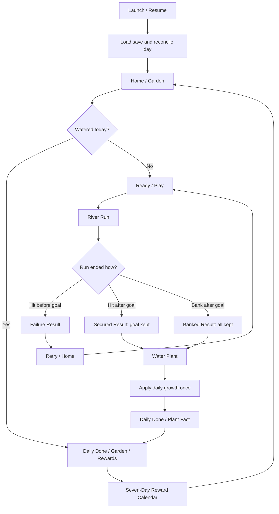

# Game Flow and Level Design Document (GFLDD)

# गंगा की बगिया (Ganga ki Bagiya)

| Field | Value |
|---|---|
| Project | Dainik Bhaskar Game Lab 2026 |
| Version | 1.0 — design baseline for review |
| Date | 12 October 2026 |
| Status | Draft; balance and content sign-off pending |
| Platforms | Unity: Android, iOS, WebGL |
| Source references | `Ganga_ki_Bagiya_Updated_Specification.md`, `Ganga_ki_Bagiya_SRS.md`, `Ganga_ki_Bagiya_TDD.md` |
| Design authority | Phase 0 first-release defaults in the decision log; remaining design/content choices explicitly **TBD** |

> **Scope:** This document describes player journeys, screen transitions, moment-to-moment play, level/difficulty progression, obstacles, daily care, reward flow, recovery, and level-design QA. It is a *design* document, not a replacement for the SRS or TDD. Numbers marked **tunable** are reference balancing values, not final commitments. The original SRS predates the later Unity/multiplatform/cloud-sync decisions; the newer confirmed decisions take precedence where they conflict.

## 1. Experience vision

**Fantasy:** Draw clean water from the Ganga into a matka, avoid disturbing river life and cultural objects, and nurture a mango tree over repeated daily visits.

**Core promise:** One-finger controls that are easy to learn, with a meaningful decision between collecting faster in dangerous lanes and banking safe water once the daily goal is secured.

**Intended player:** Hindi-first, mobile-first audience including casual/non-gamers; English toggle. Sessions are intended to feel short (reference target: 1–3 minutes per run). Accessibility and readability matter more than twitch complexity.

**Design pillars**
1. **Immediate clarity:** A touch collects, a slide changes lane, release pauses collection.
2. **Risk is optional after success:** Once the goal is reached, players may safely bank or continue for extra growth.
3. **Daily care without punishment spirals:** Failed runs can be retried; missed days reduce health but never destroy the tree or erase growth.
4. **Learning in context:** Obstacle encounters and watering reveal concise, verified river and plant facts.
5. **Indian folk-art identity:** Paper-cut layers, restrained stop-motion animation, riverside imagery, and respectful cultural presentation.

## 2. Player journey and primary game flow

### 2.1 First launch

1. Load installed or cached game assets; initial download needs internet, subsequent cached launches may run offline.
2. Load local save and reconcile eligible daily changes; if authenticated and online, attempt cloud synchronization without blocking offline play after assets are available.
3. Present title/home with the garden, current daily status, language toggle, and concise input tutorial.
4. First-time players see a short guided demonstration: hold a lane to fill the matka, slide to another lane, release to stop. Tutorial completion and replay affordance: **TBD**.
5. Enter a new river run when today's watering is pending.

**Account flow:** Use Firebase Authentication with Google sign-in for cloud sync. Players may begin as local guests and link their profile without losing progress; account linking is required only for cross-device sync. Cloud Run validates requests and accesses Firestore; local play remains available offline.

### 2.2 Daily loop

### 2.3 Screen inventory and transitions

| Screen / overlay | Entry | Essential content | Primary actions | Exit |
|---|---|---|---|---|
| Boot / Loading | App launch | Progress / offline fallback / save status | Retry on asset failure | Home or recovery notice |
| Home / Garden | Boot, run exit, daily done | Plant stage, health, watering status, rewards indicator | Play (if pending), Rewards, Language, Settings | Ready / Calendar |
| Ready / Tutorial | Play | 3-lane explanation, controls, goal, stage | Start, Back | Gameplay |
| Gameplay | Start / resume | Three lanes, pot, meter, goal, held-lane highlight, stage/day, obstacles | Hold, slide, release; Take the Pot after goal | Result / Suspended |
| Failure Result | Pre-goal hit | Water spilled, hit message, fact | Retry, Home | Ready / Home |
| Secured Result | Post-goal hit | Goal retained, excess spilled, message/fact | Continue to watering | Watering |
| Banked Result | Bank after goal | All water retained, bonus breakdown | Continue to watering | Watering |
| Watering | Qualifying run | Pouring matka, plant reaction, growth/health change | Continue (skip behavior TBD) | Daily Done |
| Daily Done | Watering committed | Watered today, stage progress, plant fact, rewards prompt | Garden, Rewards | Home / Calendar |
| Reward Calendar | Home / Daily Done | Seven days, available/claimed/forfeited/upcoming, reward type | Claim if eligible, Back | Home |
| Settings | Home | Hindi/English, audio toggles (when built), account/sync status | Save/Back | Home |
| Save/Sync Conflict | Server rejects a same-day offline duplicate | Explain that this result was not credited; preserve its local history and reconcile canonical progress | Return to safe home state |

**UI principle:** The game remains playable in portrait and landscape. Preserve the logical three-lane model and collection zone in both layouts; relocate HUD and background layers without changing hit rules, lane identities, or spawn timing.

## 3. River run — detailed state flow

### 3.1 States

| State | Entry condition | Player experience | Allowed transitions |
|---|---|---|---|
| `READY` | Run created; countdown/tutorial done | Pot empty; no simulation movement before start | `ACTIVE` |
| `ACTIVE` | First valid start | Collect/dodge; goal progress visible | `GOAL_SECURED`, `FAILED`, `SUSPENDED` |
| `GOAL_SECURED` | Water >= daily goal | Clear success cue; Take the Pot appears; play may continue | `BANKED`, `SECURED_HIT`, `SUSPENDED` |
| `FAILED` | Hit while below goal | All run water spills | Failure Result |
| `SECURED_HIT` | Hit after goal | Only goal amount kept; all excess spilled | Secured Result |
| `BANKED` | Take the Pot after goal | All water kept | Banked Result |
| `SUSPENDED` | App pauses/backgrounds/closes | Frozen simulation snapshot; no time progression | Previous active state at saved frame |
| `RESOLVED` | End result committed | Run cannot be resolved again | Result / Watering |

A bank action before the goal is unavailable. A touch release **stops collection**; it does not end the run. Obstacle overlap is harmful only in the currently held lane at the collection zone. No active held lane means no collection and no lane-hit registration.

### 3.2 Controls and collision rules

- **Touch down:** Select one valid lane and start water collection.
- **Slide while held:** Switch directly to the lane under the finger; no separate tap required.
- **Lift/cancel:** Stop collection immediately; obstacle simulation continues during active gameplay.
- **Hit:** An obstacle entering the collection zone in the held lane triggers the run-end rule for the current goal status.
- **On resume:** Restore exact saved simulation tick, water, obstacles, spawn schedule, and secured status. If touch ownership cannot be restored safely, require a new touch before collection continues; no catch-up simulation.
- **Desktop WebGL input:** Mouse/keyboard mapping **TBD**; mobile touch remains the canonical interaction model.

### 3.3 Water retention and scoring

Let `S` be current plant stage (1–6), `G = 24 + 8 × (S − 1)` the daily goal, `W` the collected water at run end, and `K` the retained water.

| Ending | Preconditions | Kept `K` | Spilled | Watering eligible? |
|---|---|---:|---:|---|
| Pre-goal hit | `W < G` | 0 | `W` | No |
| Post-goal hit | `W >= G` | `G` | `W − G` | Yes |
| Bank | `W >= G` | `W` | 0 | Yes |

**Growth points:** Below Stage 6, the one successful watering for that day awards `1 + floor(max(0, K − G) / 30)` GP, before any separately approved bounded growth-boost entitlement. Bonus points are computed from **retained** water only. A hit after reaching goal therefore normally awards no bonus. At Stage 6, further waterings grant no GP.

**Example:** Stage 1 goal is 24. Hit at 20 → keep 0, retry. Hit at 40 → keep 24, water plant, no bonus. Bank at 54 → keep 54, water plant, +1 bonus growth point.

### 3.4 Goal-secured feedback

When the meter first reaches `G`, show a strong but brief visual confirmation (e.g., matka star, goal meter highlight) and enable **Take the Pot**. Keep the bank control readable while obstacles continue. Do not imply the plant has already been watered until the qualifying run is resolved and the daily watering transaction is applied exactly once.

## 4. Level structure and progression model

### 4.1 Definition of a level

There are **no discrete, finite river levels** in the current design. Each day's river run is a repeatable skill challenge. Long-term progression is expressed through the mango plant's six visual stages and through a within-run difficulty ramp. The seven-day reward cycle is a **calendar**, not a level sequence.

A level designer therefore tunes three linked axes:
1. **Lane choice:** Faster collection carries denser/faster hazards.
2. **Run duration:** Difficulty gradually increases the longer a player stays in a run.
3. **Plant stage:** Later stages require more water and slightly faster hazards.

### 4.2 Lane balance — reference tuning

| Lane | Role | Water rate (units/s) | Base obstacle speed (reference px/s) | Relative spawn gap |
|---|---|---:|---:|---|
| Top (fast) | High reward / high risk | 7.5 | 150 | Shortest |
| Middle (medium) | Balanced | 4.2 | 100 | Medium |
| Bottom (slow) | Safer / slower | 2.2 | 62 | Longest |

These are **reference prototype values**, not final Unity world-unit speeds. Translate speeds into a fixed logical coordinate system so portrait/landscape and different resolutions have equivalent simulation difficulty.

### 4.3 Stage-by-stage design matrix

| Stage | Hindi name | Visual identity | Daily water goal | Stage progression reference | New atmosphere / visitor |
|---|---|---|---:|---|---|
| 1 | बीज (Seed) | Seed half-buried | 24 | 2 growth points to advance | Bare soil, simple leaves/ground |
| 2 | अंकुर (Sprout) | Thin stem, copper-red leaves | 32 | 2 growth points to advance | First visible leaves |
| 3 | पौधा (Seedling) | Taller stem, green/copper tips | 40 | 2 growth points to advance | Fuller leaves |
| 4 | छोटा पेड़ (Sapling) | Small trunk, leaf pairs | 48 | 3 growth points to advance | Butterfly |
| 5 | बौर (Blossom) | Flowering canopy | 56 | 3 growth points to advance | Bees |
| 6 | फल (Fruiting) | Mature canopy, mangoes | 64 | Final first-release stage; no further GP | Parrot and squirrel |

**Progression semantics:** Growth-point thresholds are per-stage and surplus carries through multiple intermediate stages in one watering. Stage 6 is capped for the first release: later watering still restores health and may grant the daily reward but adds no GP. New species such as neem are future scope, not an assumed release feature. New profiles start at Stage 1, 0 GP, and health 3.

### 4.4 Difficulty over time

- Reference in-run speed increase: up to approximately **+90% over ~80 seconds** of simulated run time.
- Reference stage modifier: approximately **+5% per plant stage** (exact application and caps **TBD**).
- Deterministic spawn tables increase challenge without creating impossible patterns.
- Time ramp must use **simulation time**, not wall-clock time; suspension must not raise difficulty.
- Player may bank immediately after goal or continue to chase bonus growth points.

**Suggested (not approved) design curve:**

| Run segment | Intended feel | Level-design intent |
|---|---|---|
| 0–15 s | Readable introduction | Teach lane trade-off; avoid immediate unavoidable hits |
| 15–35 s | Decision pressure | Introduce tighter timing and more meaningful lane switches |
| 35–60 s | Higher concentration | Reward confident hold/release decisions |
| 60–80 s | Risky bonus pursuit | Increase pressure without impossible combinations |
| 80 s+ | Sustained challenge | Cap difficulty rather than accelerating indefinitely |

The segments above are proposed pacing targets, **not** previously confirmed thresholds. Tune through playtests.

### 4.5 Deterministic pattern design

The Unity obstacle scheduler should use versioned patterns and a serializable random seed/PRNG state. Designers author spawn patterns by lane, relative time/tick, obstacle type, gap, and speed modifier. Replaying a seed and identical input timeline should yield identical outcomes.

**Pattern rules (proposed):**
- Every spawn pattern must leave at least one viable response: release, lane change, or safe lane.
- Telegraph visually distinctive hazards before their collision window.
- Avoid visual ambiguity from overlapping foreground parallax layers.
- Use short/medium/long spawn gaps by lane as a starting point; exact min-gap tables are **TBD**.
- Do not place a hazardous object directly at the collection zone on the first playable frame.
- Use data-driven pattern sets rather than hardcoding spawns into scene scripts.

**Illustrative pattern templates (conceptual, not final level content):**

| Pattern ID | Design purpose | Top | Middle | Bottom |
|---|---|---|---|---|
| `P01` | Learn release timing | Single clear hazard | Open | Open |
| `P02` | Learn lane switching | Two spaced hazards | Single hazard | Open |
| `P03` | Fast-lane temptation | Dense hazard rhythm | Moderate rhythm | Wide safe gaps |
| `P04` | Choose to bank | Increasing top pressure | Intermittent | Slow open windows |

Pattern templates require actual timestamps, hitbox sizes, and minimum response windows during production (**TBD**).

## 5. Obstacles and educational encounter design

### 5.1 Initial encounter roster

| Obstacle | Theme | Design function | Collision result | Learning-message direction |
|---|---|---|---|---|
| Plastic bag | Pollution | Readable dirty-water hazard | Normal hit rule | Plastic pollution harms river life |
| Foam / oil | Pollution | Pollution hazard with distinctive silhouette | Normal hit rule | Untreated waste pollutes rivers |
| Boat | People / livelihoods | Non-villainous object to give way to | Normal hit rule | Boats support riverside livelihoods |
| Ganga dolphin | Wildlife | Respectful wildlife encounter | Normal hit rule | Dolphin navigation / conservation |
| Golden mahseer | Wildlife | Rare, visually tempting encounter | Normal hit rule | Fish and river ecology |
| Floating diya and marigolds | Culture | Respectful avoidance | Normal hit rule | Let offerings pass undisturbed |
| Lotus | Nature | **TBD**: avoidable hazard or beneficial pickup | **TBD** | Plant and nature awareness |

All final environmental and wildlife facts require editorial verification. Do not imply the river animal or cultural object is an enemy; the player is avoiding disturbing it. Golden mahseer is rarer by concept, but its numerical spawn probability is **TBD**.

### 5.2 Encounter readability standards

- Recognizable silhouettes in the small mobile viewport.
- Distinct collision/collection-zone contrast for every lane.
- Cultural objects represented respectfully; no mocking hit feedback.
- Fact card shows after an encounter without forcing a long reading session.
- Hindi strings must fit on low-resolution screens; English copy must be separately reviewed.
- All objects use stable collision bounds independent of stepped visual animation.

### 5.3 Future content — not part of initial level set

Potential additions: turtle, fish shoal, kingfisher, net, sewage patch, sandbar, cattle, whirlpool, monsoon log, gharial, and water hyacinth. Proposed future behaviors include diving/surfacing telegraphs, cross-lane movement, two-lane hazards, and obstacle rows. Do **not** implement these as baseline mechanics without an approved content milestone.

## 6. Plant growth, daily care, and seven-day rewards

### 6.1 Plant growth and health are separate

- Growth accumulates permanently; plant appearance advances across six mango stages.
- Health is an integer **0–3**.
- For each date finalized at 00:15 after midnight without accepted watering: health decreases by **1**, minimum **0**.
- One successful daily watering restores **2** health levels, maximum **3**.
- Failed runs have **no effect** on health or growth.
- Health 0 is a wilted, recoverable state, **not death**; do not reset growth.

### 6.2 Day boundary behavior

The daily challenge resets at midnight in the profile's canonical IANA timezone, captured from the device when the profile is created. An explicit timezone change takes effect at the next day boundary and never re-keys historical progress. Server time is authoritative online; offline day events remain provisional against the last verified server-time anchor. Finalize missed-day health loss and reward forfeiture at 00:15 after midnight; do not penalize the still-current date before then.

Each run is assigned the day key at start. A run active at midnight may resolve through 00:15 in the profile timezone; no new attempt for its old day starts after midnight, and a new-day run waits while the previous run remains active. A run still unresolved at 00:15 is abandoned, and the date is reconciled as missed if watering was not completed.

### 6.3 Seven-day reward cycle

- Seven-day cycle anchored to the profile's first eligible game day, not the start of a Monday week; the cycle repeats at Day 1 after Day 7.
- Day positions advance with calendar days; missing a day **forfeits** that day's reward.
- The date's reward becomes claimable only after successful watering and expires at 00:15 after that date. Missing a day forfeits its slot without shifting later rewards.
- Claim/grant/consume events must be idempotent and persist across restarts/sync retries.
- Exact Day 1–7 reward items and any boost magnitude/duration remain to be selected before reward implementation.

| Calendar state | Meaning | Display expectation |
|---|---|---|
| Upcoming | Future calendar day | Reward preview, not claimable |
| Available | Eligible current-day reward, if claim rules met | Clearly highlighted claim action |
| Claimed | Entitlement already applied | Checkmark / no second grant |
| Forfeited | Eligible day elapsed unclaimed | Clearly marked missed; no make-up claim |

**Important:** Any future growth boost must not bypass the one-watering-per-day restriction or Stage 6 cap. Its exact bounded effect remains a reward-content decision.

## 7. Economy and player feedback

There is **no monetization**. The progression economy consists only of water collected within runs, growth points, plant health, cosmetic unlocks, and approved reward boosts.

| Feedback moment | Required information | Intended emotion |
|---|---|---|
| Water starts flowing | Selected lane and rising meter | Immediate agency |
| Lane switch | Clear selected-lane highlight | Control and mastery |
| Near daily goal | Readable progress remaining | Anticipation |
| Goal secured | Bank button and safe-goal cue | Relief / choice |
| Pre-goal hit | Water lost; retry available | Learning without lasting penalty |
| Post-goal hit | Goal kept; extra lost | Fair consequence |
| Bank | Full retained amount and bonus | Smart risk management |
| Watering | Health restoration / stage progress | Daily accomplishment |
| Missed day | Wilted plant and recoverable health | Gentle return motivation |
| Reward claim | Cosmetic or boost entitlement | Recognition, not pressure |

## 8. Visual, camera, and audio direction

### 8.1 Unity 2.5D visual composition

Use layered 2D art at distinct parallax depths: distant skyline/clouds, midground ghats/temple/factory/tree, river surface and obstacles, collection zone, foreground matka/HUD. The folk paper-cut look uses cream cut edges, hard offset shadows, paper grain, and warm marigold/pink/terracotta accents against indigo/blue water. The fastest lane reads as the darkest river lane.

**Animation:** Reference style is stepped/stop-motion-like motion at approximately 12 fps for selected visual animation; gameplay physics and collision must remain deterministic at the simulation tick rate, not 12 fps.

**Typography:** Hind for body copy; Yatra One for titles (subject to licensing and asset inclusion review).

### 8.2 Responsive layouts

| Layout | Primary arrangement | Constraints |
|---|---|---|
| Portrait phone | Three river lanes across central play area; matka and goal meter on right | Large touch targets, no HUD overlap |
| Landscape phone / web | Preserve river geometry; shift garden/status to available side space | Same logical lanes and collision windows |
| Tablet / desktop web | Scale gameplay viewport with side panels or letterboxing | No altered lane speeds or timings |

Safe areas, notch cutouts, accessibility font sizing, and desktop control mapping need device validation. Camera/parallax must never obscure an incoming hazard or the collection zone.

### 8.3 Audio plan

Planned sounds: river ambience, collection splash, clay-pot tap, plant growth cue, and distinct obstacle-hit cues. Audio is not confirmed as built. Include independent mute control when implemented. Do not require audio to identify success, failure, or an incoming obstacle.

## 9. Save/resume and cross-device continuity in game flow

1. Persist the current run's deterministic simulation state and daily progression separately.
2. On background/close, freeze the run; do not advance elapsed simulation time.
3. Checkpoint at least every 2 simulated seconds, on critical transitions, and before background/pause. On graceful relaunch, restore the same committed logical tick; after force-kill, restore the latest valid checkpoint (normally no more than 2 simulated seconds behind if writes succeeded).
4. Resume from that tick, requiring a fresh touch if the previous held touch cannot safely be restored.
5. Commit successful watering and rewards **once**, using stable event IDs to prevent duplicates.
6. Queue offline changes and reconcile with the account-based cloud save on reconnect.

**Design caveat:** Unsaved per-frame state after sudden termination is not guaranteed. Use versioned atomic snapshots, an event/outbox journal and last-good backup; require fresh touch after restore. An active run at midnight stays on its start-day key through 00:15; unresolved runs then expire and are reconciled as missed if unwatered. The first valid server transaction wins for same-account/day watering; a losing offline event stays in local conflict history, is clearly explained, and cannot silently duplicate or overwrite confirmed progress. Active runs remain device-local.

## 10. Level-design test plan

### 10.1 Functional scenarios

| ID | Scenario | Expected result |
|---|---|---|
| GF-01 | Hold top/middle/bottom lane for equal simulated duration | Water rises at each configured rate |
| GF-02 | Slide finger across lanes while held | Collection immediately follows selected lane |
| GF-03 | Lift finger before an obstacle reaches zone | Collection stops; no held-lane hit |
| GF-04 | Obstacle enters another lane's collection zone | No hit |
| GF-05 | Hit at `W < G` | Run fails, all water lost, unlimited retry |
| GF-06 | Hit at `W >= G` | Goal retained, excess lost, watering allowed |
| GF-07 | Bank at `W >= G` | All water retained; correct bonus points |
| GF-08 | Attempt to bank at `W < G` | Bank action unavailable |
| GF-09 | Retry after pre-goal hit | No daily watering consumed; health/growth unchanged |
| GF-10 | Complete one watering, then try to water again same day | No duplicate growth, health, or rewards |
| GF-11 | Miss 3 full days at health 3 | Health reaches 0; growth remains |
| GF-12 | Water at health 0 | Health restores to 2 |
| GF-13 | Miss reward-calendar day | That day's reward forfeited; calendar not shifted |
| GF-14 | Relaunch mid-run | Same persisted simulation tick and obstacle state; no catch-up |
| GF-15 | Switch portrait to landscape during run | Logical lane/collision outcomes unchanged |
| GF-16 | Reconnect after offline watering | No duplicate cloud/local watering or reward grant |
| GF-17 | Reuse same seed/input log | Deterministic replay matches original |
| GF-18 | Change language during non-critical screen | No loss of progress; text remains readable |

### 10.2 Balance and usability playtests

Measure (targets **TBD**): first-try tutorial completion, time to first goal, average retries per watering, lane occupancy, pre-goal vs post-goal hit rate, proportion of players who bank immediately, average bonus growth points, run duration, and daily return rate. Evaluate by plant stage and by portrait/landscape layout. Ensure no spawn pattern forces a hit under the intended response-time assumptions.

### 10.3 Content QA

Every obstacle needs reviewed Hindi/English names, respectful hit copy, an editorially verified fact, sprite readability at smallest target resolution, a documented collision boundary, and an assigned spawn/pattern role. The lotus mechanic must be decided before content lock.

## 11. Production sequence (recommended)

| Milestone | Design deliverable | Exit check |
|---|---|---|
| M1 — Vertical slice | 3 lanes, one obstacle, collection, hit, bank | Entire one-run loop playable |
| M2 — Run balance | Deterministic patterns, 7 encounter types, goal secured | Risk/reward outcomes pass GF-01–08 |
| M3 — Daily care | Mango stages, growth points, health, day reconciliation | GF-09–12 pass |
| M4 — Retention | Seven-day rewards, cosmetic and boost hooks | GF-13 and duplicate-claim tests pass |
| M5 — Persistence | Save/resume, cloud synchronization, recovery | GF-14, GF-16–17 pass |
| M6 — Polish / release | Adaptive layouts, localization, visual/audio polish | GF-15, GF-18; device QA and content sign-off |

These milestones are **recommended planning groupings**, not approved release dates.

## 12. Remaining decisions for later phases

| ID | Open decision | Why it matters |
|---|---|---|
| LD-01 | Lotus: hazard, bonus, or remove | Collision/scoring consistency; confirm before roster/content lock |
| LD-02 | Exact spawn gap tables, pattern timing, difficulty cap | Fairness and deterministic replay |
| LD-03 | Seven reward items and any boost magnitude/duration | Economy and UX; before reward implementation |
| LD-04 | Desktop input mapping and minimum responsive resolutions | Follow-on WebGL usability |
| LD-05 | Tutorial skip/replay and onboarding length | First-session experience |
| LD-06 | Approved performance, balance, and accessibility targets | Release acceptance |
| LD-07 | Audio playback/haptics scope | Separate product decision; hooks only for now |
| LD-08 | Editorial verification, citations and localization sign-off | Cultural/scientific accuracy |

## 13. Change control and traceability

- **SRS:** Authoritative for player-visible requirements; reconcile its earlier mobile-web/no-account assumptions with the newer Unity and cloud-sync decisions.
- **TDD:** Authoritative for engine implementation, deterministic simulation, persistence, authentication, and deployment details.
- **This document:** Authoritative for player flow, screen-level experience, level pacing, encounter roles, and balance intent after design sign-off.
- Record each approved change with a version, owner, date, affected flow/level tables, and associated SRS/TDD requirement IDs.
- Store lane rates, stage goals, thresholds, patterns, rewards, and localization keys as versioned data/configuration; do not bury level-balance values in scene-specific scripts.

---

**Document status:** Phase 0 flow and calendar/save/account defaults are aligned with the [decision log](./Phase_0_Audit_and_Decisions.md). Remaining decisions above are for later implementation and release gates, not blockers to beginning Phase 1.
