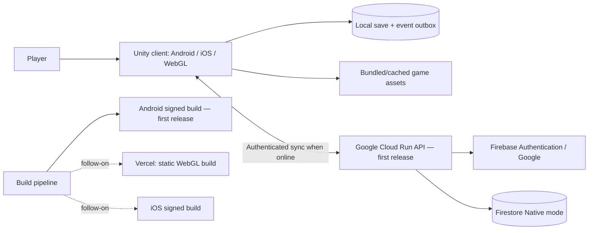
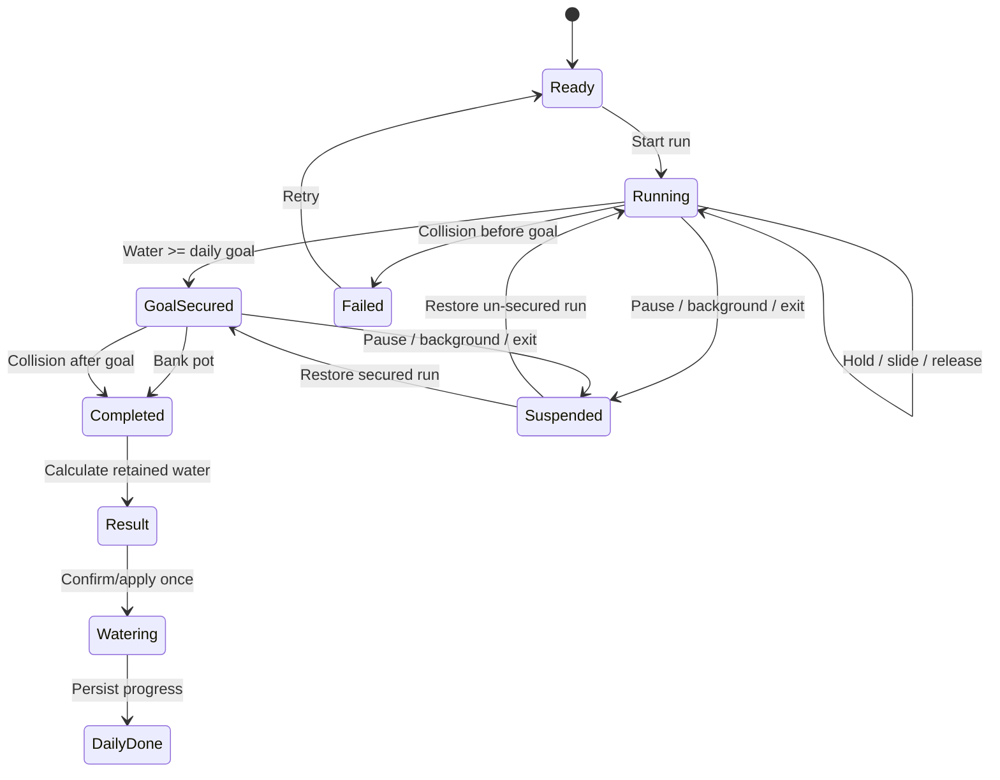

# Technical Design Document (TDD)

# गंगा की बगिया — Ganga ki Bagiya

| Field | Value |
|---|---|
| Project | Dainik Bhaskar Game Lab 2026 |
| Document version | 0.3 — Phase 0 baseline |
| Date | 12 October 2026 |
| Status | **Phase 0 baseline; implementation and release details pending** |
| Source repository | https://github.com/anandsharmacy/Ganga_ki_bagiya.git |
| Primary references | `Ganga_ki_Bagiya_SRS.md`, `Ganga_ki_Bagiya_Updated_Specification.md`, GDD, and TDD discovery decisions (Phases 1–2) |
| Owners / approvers | TBD |

> **Current baseline:** Unity/C# is the production client. The first release targets Android; iOS and Web are follow-on targets. Account-based progression sync through Google Cloud Run is required in the first release, and the client remains local-first and playable when offline. A standalone HTML game prototype is available as a behavior reference; the Unity implementation remains greenfield. Phase 0 selects Firebase Authentication with Google sign-in and guest linking, Firestore Native mode behind one stateless Cloud Run API service, a pinned account timezone, and server-transaction conflict handling. See the Phase 0 decision log for the acceptance baseline.
>
> **Decision legend:** **Confirmed** = explicitly selected by project owner; **Phase 0 baseline** = selected to complete project planning and subject to revision before deployment/release; **Proposed** = an implementation recommendation not yet selected; **TBD** = unresolved; **Future** = not committed to first release. This document is an engineering design, not a claim that the Unity production game is implemented.

## 1. Purpose and scope

This TDD specifies a feasible Unity implementation for the three-lane water-collection game, plant care, daily progression, seven-day rewards, local-first saves, exact-frame recovery, and cross-device cloud synchronization. It covers client architecture, data models, algorithms, interfaces, security, build/deployment, testing, and technical risks.

**In scope:** Unity runtime, deterministic gameplay, 2.5D art presentation, touch/pointer input, responsive UI, progression, local persistence, identity/cloud synchronization architecture, offline launch/play, Hindi/English localization, content pipeline, WebGL and native build targets.

**Excluded unless separately approved:** monetization, ads, real-money rewards, multiplayer, competitive leaderboards, additional tree species, regional river expansions, and elaborate live operations.

## 2. Confirmed decisions and unresolved architecture

| Area | Decision | Status |
|---|---|---|
| Engine / language | Unity / C# | Confirmed |
| Platforms / release order | Android first release; iOS and Web follow-on targets | Confirmed |
| Prototype | Standalone playable HTML prototype exists; Unity gameplay implementation is greenfield | Confirmed |
| Presentation | 2.5D layered depth and parallax | Confirmed |
| Spawns | Deterministic patterns, increasing difficulty | Confirmed |
| Collision | Unity 2D colliders and triggers | Confirmed |
| Controls | Hold lane, slide vertically to switch, release to stop | Confirmed |
| Recovery | Restore exact latest committed logical tick after graceful suspension; latest durable checkpoint after forced termination | Phase 0 baseline |
| Launch connectivity | Initial download online; cached subsequent launches may be offline | Confirmed |
| Reward calendar | Seven calendar-day cycle anchored to the profile's first eligible game day; repeats after Day 7; reward claimable after watering through 00:15 after the date | Phase 0 baseline |
| Rewards | Cosmetics and growth boosts | Confirmed; contents TBD |
| Sync | Account-based cross-device progression sync through Google Cloud Run | Confirmed for first release; API details TBD |
| Layout | Adaptive portrait and landscape | Confirmed |
| Web hosting | Vercel for Unity WebGL artifacts | Confirmed for follow-on Web target |
| Native distribution | Android/iOS signing, stores/test channels | TBD |
| Backend/API hosting | Google Cloud Run | Confirmed for first release |
| Data store | Firestore Native mode, accessed by Cloud Run service identity | Phase 0 baseline |
| Authentication | Firebase Authentication, Google sign-in; local guest play and guest-to-account linking | Phase 0 baseline; detailed recovery/consent TBD |
| Persistence | Versioned local snapshot + event/outbox journal + last-good backup; ≤2 simulated-second checkpoints plus transitions/pause | Phase 0 baseline |
| Cloud conflict resolution | One server-committed watering per account/day; first valid commit wins; losing offline event surfaced and retained locally | Phase 0 baseline |
| Day boundary | Canonical profile IANA timezone captured at profile creation; server time online, provisional last-verified anchor offline | Phase 0 baseline |
| Audio playback | No sound assets/playback in first release; audio event hooks prepared | Playback undecided |
| Analytics, anti-cheat, remote content | Scope and vendors | TBD |

## 3. Architectural overview

### 3.1 Context diagram



**Runtime principle:** Game simulation never depends on a live backend request. Local gameplay is responsive and available offline after installation/caching. Cloud state is reconciled separately; network latency cannot pause a run.

### 3.2 Logical layers

1. **Presentation:** scenes, responsive HUD, animations, audio, accessibility, localization.
2. **Input:** Unity Input System pointer/touch adapters; translates screen positions into logical lane actions.
3. **Simulation:** fixed-step deterministic run state, spawn schedule, water accumulation, hit resolution, banking.
4. **Domain:** daily goal, growth points, plant stages, health, reward entitlement, calendar reconciliation.
5. **Persistence:** atomic local snapshots, save versioning, checksums, recovery journal, offline event outbox.
6. **Identity/sync:** sign-in, authenticated API client, upload/download, idempotency and conflict handling.
7. **Content/configuration:** ScriptableObject definitions, localization tables, vetted fact catalog, versioned balance values.

Use interfaces to isolate platform-specific storage, authentication, time, and network dependencies from domain logic. Avoid a single global `GameManager` with all responsibilities.

### 3.3 Suggested Unity project layout

```text
Assets/
  _GangaKiBagiya/
    Art/{Sprites,Layers,Animations,Materials,Fonts}/
    Audio/{Music,SFX}/
    Config/{Balance,Obstacles,Plants,Rewards}/
    Localization/{StringTables,Fonts}/
    Prefabs/{River,Obstacles,UI,Plant}/
    Scenes/{Boot,Home,RiverRun,Result,Garden}/
    Scripts/
      Core/{Bootstrap,Clock,Random,Events}/
      Gameplay/{RunState,RunSimulator,LaneInput,Spawner,Collision,Water}/
      Progression/{DailyCare,PlantGrowth,RewardCalendar}/
      Persistence/{SaveRepository,Snapshot,Journal,Migrations}/
      Sync/{Auth,SyncCoordinator,ConflictResolver,ApiClient}/
      UI/{HUD,Navigation,ResponsiveLayout,Localization}/
      Platform/{StorageAdapters,WebGLBridge}/
    Tests/{EditMode,PlayMode,Integration}/
Packages/
ProjectSettings/
```

Paths are **proposed**, not asserted to exist in the repository.

## 4. Unity runtime and rendering design

### 4.1 Engine configuration

- Pin the installed Unity editor version (`6000.6.4f1`) and lock package versions in source control; review the version before upgrading the project.
- Use a 2D physics world with an orthographic gameplay camera; 2.5D depth comes from layered sprites, sorting groups, controlled parallax, shadows and animation, not necessarily 3D rigid-body physics.
- Use Unity Input System and Unity UI (uGUI or UI Toolkit **TBD**) with a consistent logical coordinate space.
- Configure portrait and landscape layouts independently; safe areas, notches and aspect-ratio extremes must be handled.
- Keep simulation and visual rendering separate: rendering interpolates simulation state; frame-rate variation must not change water collected or obstacle outcomes.

### 4.2 River coordinate model

Represent three lanes as logical IDs `0=top`, `1=middle`, `2=bottom`, with lane center positions defined in a responsive gameplay viewport. Obstacles move from left to right toward a right-side collection zone. Layout changes may reposition visuals but **must not alter logical lane selection, hit ordering, spawn timeline, or water totals**.

### 4.3 Parallax and visual composition

Suggested draw order: distant skyline → riverbank → water surface → floating objects → collection zone/matka → foreground vegetation → HUD. Background layers shift by small, bounded offsets on camera or environmental motion; disable excessive movement for reduced-motion settings. Retain paper-cut / Indian folk art direction, stepped animation where appropriate, Hindi-friendly typography and readable contrast. All art and fonts require distribution rights verification.

### 4.4 Performance policy

- Pool obstacles, splash effects and short-lived UI effects; avoid instantiating/destroying per obstacle.
- Preload frequently used sprites and localized strings for each run.
- Avoid per-frame allocations, synchronous file I/O in gameplay, expensive shader effects and uncontrolled overdraw.
- Use platform-specific texture compression, sprite atlases and build stripping after profiling.
- Define target FPS, memory, first-load time, WebGL compressed download size, and minimum supported OS/browser/device matrix before acceptance (**TBD**).

### 4.5 Phase 1 implementation snapshot

The Phase 1 vertical slice is wired into `Assets/Scenes/SampleScene.unity`. `Assets/GangaKiBagiya/Scripts/Phase1GameController.cs` owns presentation and touch/mouse input; the serializable `Phase1Tuning` keeps goal, lane rates, spawn gaps, reference speeds, and difficulty values together; `Phase1RunSimulation` advances the run on a fixed 50 Hz tick. The scene references all six background PNGs, all three river PNGs, and all ten obstacle PNGs. Boat, diya, dolphin, plastic, and pollution are the current generic hit hazards; croc, dirt, both fish, and flower are displayed as non-colliding scenery until their later content roles are approved.

The run shows the pot meter and supports start, hold/slide/release lane input, pre-goal failure, goal-secured continuation, banking, and retry. The collector and pooled obstacles carry kinematic 2D trigger colliders; the fixed-step logical lane/crossing check remains authoritative for hit ordering and result math. The result applies the Phase 0 retained/spilled rules and computes bonus growth points only from retained water. Named collection, hit, goal-secured, and banking audio events are exposed without loading or playing audio. The seven EditMode tests pass in Unity. `Builds/Android/GangaKiBagiya-Phase1.apk` was built and package/signature-verified; on-device acceptance remains pending. This test APK is signed with Unity's Android Debug certificate and uses the placeholder package ID, so production signing and package identity are still required before store distribution.

### 4.6 Phase 2 implementation snapshot

`Phase2PlantProgression` applies the Phase 0 mango baseline: Stage 1/0 GP/health 3 initially; configurable 2/2/2/3/3 stage thresholds; carried surplus through Stage 6; health clamped to 0–3; +2 health on an eligible successful watering; and one watering or missed-day health change per date during the current session. The controller passes the run's captured stage to the daily goal, permits retries after failed runs, applies growth only for banked or goal-secured-hit results, and shows stage, GP progress, health and today's watering status in the HUD. A prior-day run may finish through 00:15; missed dates reduce health without removing growth. All 14 EditMode tests pass. `Builds/Android/GangaKiBagiya-Phase2.apk` was built and package/signature-verified for arm64-v8a.

This is an in-memory prototype: progression resets on app relaunch and dates use the device's local clock. Versioned local persistence and canonical profile-timezone reconciliation remain Phase 3. Mango-stage art is not present in the supplied assets and remains Phase 7 content; the current HUD identifies the stage textually. The test APK uses Unity's Android Debug certificate and the placeholder package ID; it is not production-signed, and no device acceptance test has been run.

## 5. Gameplay simulation design

### 5.1 State machine



`GoalSecured` is logically a running state with `secured=true`; implement either as a substate or explicit flag, not two divergent simulators. The transition to `Watering` must be idempotent.

### 5.2 Fixed-step update

**Proposed:** advance gameplay in a fixed simulation tick (e.g., 50 Hz, **value TBD**). Each tick consumes timestamped logical input, advances obstacles, checks collision in a stable order, increments water for held lanes, resolves goal/bank/hit, and emits events. Do not base authoritative simulation on `Time.deltaTime` from rendered frames.

```text
for each simulation tick:
  apply input commands for tick in stable order
  spawn all scheduled obstacles due this tick
  move obstacles using fixed-step rules
  evaluate collisions against active held lane / collection zone
  if hit: resolve loss and finish run; do not award this tick's water after hit
  else if collecting: add lane water rate × tick duration
  if water >= dailyGoal: set secured=true (once)
  if bank requested and secured: finish with retained=collected
  emit immutable tick events and update render snapshot
```

The Phase 0 same-tick precedence is locked for planning: process input and obstacle motion, evaluate collision first, then add water and secure the goal, then process a bank request. A collision wins if it occurs in the same tick that water would otherwise reach the goal. For exact recovery, store the tick index and every state variable needed to reproduce the next tick.

### 5.3 Lane configuration (tunable baseline)

| Lane | Rate (water/s) | Base obstacle speed (px/s in reference coordinate system) | Gap |
|---|---:|---:|---|
| Top | 7.5 | 150 | Shortest |
| Middle | 4.2 | 100 | Medium |
| Bottom | 2.2 | 62 | Longest |

These values originate in the game write-up and are **not** final balance targets. In Unity, convert reference-pixel speed to logical world units so results are independent of screen resolution and orientation.

**Proposed difficulty:** deterministic speed multiplier ramp up to approximately +90% over 80 simulated seconds, with approximately +5% per plant stage, capped and configured centrally. Exact function, gap tables and cap are TBD.

### 5.4 Deterministic obstacle scheduler

Each run has `runId`, `seed`, `contentVersion`, `balanceVersion`, and a monotonic `tick`. The spawner uses a known PRNG algorithm with explicit serializable internal state, plus versioned spawn tables. Avoid Unity global random state for gameplay determinism. Maintain a serialized queue of pending spawns and active obstacle records (`obstacleId`, type, lane, position, velocity, spawnTick, behaviorState).

Unity physics callbacks are useful for collision detection, but their ordering and floating-point behavior are **not guaranteed identical across platforms**. Therefore:
- Use 2D colliders/triggers for visual/runtime collision detection as selected.
- Implement a **deterministic logical overlap test** against the collection zone for canonical hit decisions (recommended), or document the weaker cross-platform determinism guarantee if physics callbacks are authoritative.
- Sort simultaneous collisions by tick, lane, and stable obstacle ID.
- Verify deterministic replay on Android, iOS and WebGL before promising byte-identical cross-device outcomes.

### 5.5 Hit and banking algorithm

Let `G = 24 + 8 × (plantStage − 1)` and `W` be collected water at run end.

| Event | Retained water | Spilled water | Watering secured |
|---|---:|---:|---|
| Hit with `W < G` | `0` | `W` | No |
| Hit after goal secured | `G` | `max(0, W−G)` | Yes |
| Bank after goal secured | `W` | `0` | Yes |

Water may be represented as fixed-point integers (e.g., thousandths of a unit) to avoid drift. Use consistent rounding rules in HUD and domain calculations. Below Stage 6, `bonusGP = floor(max(0, retained−G) / 30)` and successful watering grants `1 + bonusGP` growth points, subject to any approved bounded growth-boost reward. At Stage 6, GP is capped at zero additional accumulation and growth boosts cannot bypass that cap; successful watering still applies health and reward effects. A failed run never reduces plant health.

### 5.6 Obstacles and fact content

Initial obstacle definitions: plastic bag, foam/oil, boat, Ganga dolphin, golden mahseer, floating diya/marigolds, lotus. Each content record specifies ID, sprite/animation, lane/spawn eligibility, collision bounds, hit message key, fact key, and editorial review status. **Lotus-as-obstacle vs bonus** remains a content decision; do not silently alter behavior. Facts about wildlife, pollution and cultural practices require editorial/source verification before release.

## 6. Plant and daily progression

### 6.1 Domain model

- Mango tree: six visible growth stages; per-stage thresholds follow the SRS baseline (2, 2, 2, 3, 3 growth points). Carry surplus across all intermediate thresholds in one watering; Stage 6 caps first-release GP accumulation.
- New profile: Stage 1 mango, 0 GP, health 3; the profile-creation game day is the seven-day calendar anchor.
- Health: integer `0..3`; plant never permanently dies.
- Watering: once per canonical game day; restores health by `min(3, health+2)` and adds GP below Stage 6.
- Missed days: each missed eligible day reduces health by one, down to zero; accumulated growth never decreases.
- Unlimited failed attempts before a successful watering.
- Once watering is secured during a run, a later hit still leads to that day's watering; bonus water is forfeited.
- Stage 6 remains the final first-release stage. Later watering still restores health and may grant the daily reward, but grants no GP until a new species is approved; additional species are future scope.

### 6.2 Day reconciliation

Store a per-account canonical IANA timezone captured from the device at profile creation. An explicit timezone change takes effect at the next day boundary and never rewrites historical day keys. The server derives canonical day keys from server time and the profile timezone. Offline play uses the last verified server-time anchor; affected events remain provisional until synchronization.

On app entry, resume, and sync:

```text
now = server time, or the last verified server-time anchor while offline
resolve current gameDayKey from the profile IANA timezone
for each date after lastReconciledDay whose midnight + 15-minute grace has passed:
    if no accepted watering for that date: health = max(0, health - 1)
    forfeit that date's unclaimed reward
    mark the date finalized
if a run from the prior date is active and its grace has not expired:
    allow only that already-started run to resolve; do not start a new-day run yet
else if current day is not watered:
    make the current day's watering available
advance the seven-day calendar by calendar date and persist reconciliation idempotently
```

**Boundary rule:** do not penalize the current unfinished day before its midnight passes. Finalize a date at 00:15 after its midnight boundary so an already-active run may finish in that grace; no new attempt for an old date may start after midnight. Do not double-penalize missed days after repeated launches or sync. At the deadline, abandon an unresolved run and reconcile the date as missed if watering was not completed.

### 6.3 Seven-day reward calendar

Calendar anchor = the profile's first eligible game day; cycle index `((dayIndexFromAnchor mod 7) + 7) mod 7`. The calendar advances every date and repeats at Day 1 after Day 7. The reward for that date becomes claimable only after successful watering and expires at 00:15 after that date; missed rewards are forfeited and do not shift. Exact reward items and any growth-boost values/caps remain content/economy work. Claims are keyed by account, game-day and slot and are idempotent.

**Proposed safety:** cosmetic unlocks are set-union entitlements; growth boosts are server-validated, single-use or explicitly bounded entitlements with immutable claim/consume IDs. Applying a boost must never duplicate watering or growth when sync retries or bypass the Stage 6 cap.

## 7. Save-state and exact-frame recovery

### 7.1 Local persistence strategy (proposed)

Use a **versioned snapshot + append-only event/outbox journal + last-good backup** behind `ISaveRepository`. On Android, write under Unity's persistent application data directory with temporary-file + flush + atomic replace/backup where supported. Checkpoint at least every 2 simulated seconds during active play, on critical state transitions and before pause/background; benchmark the cadence on target devices. On WebGL, use Unity's browser-backed persistent file system and explicitly synchronize writes to browser storage; validate behavior across browsers, storage quotas, private browsing and tab termination. Do not assume a write is durable merely because it completed in memory.

Save the following independently:

| Record | Required fields |
|---|---|
| Profile | schemaVersion, localProfileId, accountId (optional until sign-in policy set), language, settings |
| Progress | plantSpecies, stage, growthPoints, health, lastReconciledDay, lastWateredDay |
| Rewards | anchorDay, cycleIndex, claim IDs, owned cosmetics, boost inventory/consumption IDs |
| Active run | runId, dayKey, tick, state, heldLane, input state, collected fixed-point water, secured flag, goal, PRNG state, spawn queue, active obstacles, pending events, content/balance version |
| Sync metadata | local revision, server revision/token, device ID, outbox event IDs, last successful sync, clock anchor |
| Integrity | snapshot version, checksum/hash, write sequence, previous valid backup reference |

### 7.2 Recovery contract

“Exact frame” means the next **logical simulation tick** after restore has the same state and produces the same outcomes when given the same subsequent inputs. Pixel-perfect continuation of animations/audio and restoration of an unsaved physical frame after abrupt power loss are **not guaranteed** without a successful durable checkpoint.

- On normal pause/background/quit: freeze simulation first, snapshot full run, persist and flush before returning if platform permits.
- On browser refresh/crash/forced termination: recover last **durable** checkpoint; replay journaled input/events up to last durable tick, if available.
- After forced termination, restore the latest valid durable checkpoint. With successful storage writes, active-run recovery normally loses no more than 2 simulated seconds; storage failures retain the last-good checkpoint and must surface a recoverable warning. Do not promise recovery of unsaved per-frame state.
- Never claim recovery of events not persisted before an ungraceful shutdown.
- Save migration must be versioned; invalid or corrupt save loads last valid backup and surfaces a recoverable warning. Do not erase confirmed cloud progress silently.

### 7.3 Atomic watering transaction

Model a completed watering as `WateringCompleted(profileId, dayKey, runId, retainedWater, bonusGP, contentVersion, eventId)`. Apply at most once for each `(profileId, dayKey)`. A local transaction updates the plant, reward effects and journal together; cloud acceptance repeats the same idempotency check. If local state is pending sync, mark it clearly without interrupting gameplay.

## 8. Identity, backend and cloud synchronization

### 8.1 Status and candidate stack

**Google Cloud Run is the selected API hosting target for the first release.** The Phase 0 service baseline is one stateless HTTPS API service, Firebase Authentication with Google sign-in, and Firestore Native mode. The API validates Firebase ID tokens and uses its Cloud Run service identity to access Firestore; the Unity client never accesses the privileged store directly. Local guest play is permitted; linking/signing in is required to synchronize across devices and preserves the local profile. Region, detailed account recovery, consent, and operational cost remain TBD. Cloud Run requests are asynchronous and never participate in real-time gameplay.

**Proposed interfaces:** `IAuthService`, `ISyncTransport`, `ISyncCoordinator`, `IClockAuthority`, `IConflictResolver`. Credentials and privileged server keys must **never** be embedded in Unity builds or Vercel static files.

### 8.2 Proposed sync protocol

1. Play locally as a guest without authentication; when the player links/signs in with Google through Firebase Authentication, authenticate sync requests with a Firebase ID token.
2. Client loads last local verified progress immediately.
3. Queue immutable domain events in a durable outbox with UUID event IDs, day keys, run IDs and monotonic local sequence numbers.
4. On reconnect, send unsent events with auth token, client schema version and expected server revision.
5. Server validates ownership, idempotency, day eligibility, reward limits and progression invariants; returns accepted/rejected event IDs and canonical state/revision.
6. Client commits acknowledgements, reconciles canonical progress, and refreshes local snapshot; rejected/conflicting events are surfaced or handled by documented policy.
7. Use exponential backoff and bounded retries; no network operation should block input or frame simulation.

**Proposed API contracts (not finalized):**

```http
POST /v1/sync/events
Authorization: Bearer <access_token>
Content-Type: application/json

{
  "deviceId": "uuid",
  "baseRevision": 42,
  "schemaVersion": 1,
  "events": [
    {"eventId":"uuid", "type":"WateringCompleted", "dayKey":"2026-10-12",
     "runId":"uuid", "retainedMilliUnits":24000, "bonusGrowth":0}
  ]
}
```

```json
{
  "serverRevision": 43,
  "acceptedEventIds": ["uuid"],
  "rejected": [],
  "canonicalProgress": {"stage": 1, "growthPoints": 1, "health": 3}
}
```

Examples illustrate shape only; they do **not** imply a deployed API. The Cloud Run service must enforce account ownership and validate progression server-side; clients must not write directly to a privileged data store.

### 8.3 Multi-device and offline conflicts

A single account can have divergent offline histories. **Do not use blind last-write-wins for plant growth or consumable rewards.** Phase 0 baseline merge policy:

- Completed watering: unique per canonical account + day; first valid event committed in a Firestore transaction wins, duplicate event IDs are no-ops.
- Cosmetics: set union of validated grants.
- Consumable boosts: uniquely identified grant/consume events; reject double spend.
- Missed-day penalties: derive from authoritative day history, not independent additive device writes.
- Active run: device-local only; do not transfer partially completed runs between devices.
- Contradictory offline actions on the same day: server accepts only the first valid transaction; later events receive a conflict response. The client retains the losing event/run in local conflict history, explains that it was not credited, and reconciles canonical progression without silently overwriting confirmed cloud data.

Offline reward and watering effects are provisional until validated. Pending status must be visible; rejected events must not silently change canonical progression. Guest-to-account linking must preserve local progress. Account deletion, logout with unsynced data, device replacement, recovery and final conflict copy remain product/security decisions before release.

### 8.4 Security and privacy

- TLS for all authenticated traffic; secure platform token storage where available.
- Do not store passwords in custom game files.
- Minimize personal data; collect only what is necessary for identity, progress and support.
- Use server-side access control, rate limits, schema validation, replay protection and audit logging for reward-bearing events.
- Define age/privacy notice, consent, retention, export/deletion, and analytics policy before release.
- **Anti-cheat limit:** offline clients cannot be fully trusted. A server can detect inconsistent claims but cannot conclusively prove unobserved offline gameplay without additional attestation or online verification. Treat cosmetic/boost fairness as a risk and specify an acceptable threat model.

## 9. UI, localization and accessibility

### 9.1 Scenes and navigation

`Boot` → `Home/Ready` → `RiverRun` → `Result` → `Garden/Watering` → `DailyDone`, with a Rewards overlay and Settings/Account overlay. Boot initializes storage, checks migrations, loads cached content, optionally starts auth/sync, reconciles days and restores suspended runs.

### 9.2 Responsive design

- Portrait: vertical emphasis, large lane targets, matka/HUD aligned away from finger occlusion.
- Landscape: retain three horizontal logical lanes; reorganize HUD and garden panel without changing gameplay physics.
- Recalculate input mapping on orientation changes; suspend and snapshot before layout transition, then resume with same logical state.
- Respect safe areas, dynamic resolution and readable minimum touch-target sizes (exact measurements **TBD**).

### 9.3 Localization

Hindi first, English toggle. Store all UI, obstacle facts, errors and reward names as localization keys; avoid hard-coded text in prefabs. Test Devanagari shaping, line wrapping, numerals and font fallback on native and WebGL builds. Environmental/cultural facts must pass editorial review and translation QA.

### 9.4 Audio and accessibility

Audio playback remains undecided. Prepare named, no-op-capable audio event hooks for gameplay and UI feedback, but include no sound assets or enabled playback in the first release. Mute controls, haptics, reduced-motion support, color-independent lane identification, captions, and screen-reader strategy remain TBD.

## 10. Content and configuration schemas

**Proposed ScriptableObject types:** `RiverBalanceConfig`, `LaneConfig`, `ObstacleDefinition`, `PlantDefinition`, `RewardCalendarDefinition`, `LocalizationCatalog`, `VisualThemeConfig`. Persist immutable content IDs and version numbers in saves, **not Unity object references**. Remote-configurable values are **TBD**; if introduced, version and sign the content manifests and retain compatibility for suspended runs.

Example balance model:

```csharp
[Serializable]
public struct LaneBalance {
    public int LaneId;
    public int WaterMilliUnitsPerSecond;
    public float ObstacleWorldUnitsPerSecond;
    public int MinimumSpawnGapTicks;
}
```

The serialized authoritative water quantity uses integer milli-units. Floating-point obstacle positions must be quantized or otherwise stabilized if strict replay equivalence is required.

## 11. Build, deployment and CI/CD

### 11.1 Source control

Use the provided GitHub repository as the canonical source once access/contents are reviewed. Commit Unity `Assets`, `Packages`, `ProjectSettings` and `.meta` files; exclude `Library`, `Temp`, `Obj`, `Build`, local secrets and generated caches. Enable Unity YAML text serialization and visible meta files. Use Git LFS for large binary assets as needed.

### 11.2 WebGL → Vercel (follow-on platform)

1. Build Unity WebGL in CI with a pinned editor version.
2. Upload the **static WebGL output** to Vercel, with appropriate MIME types, compression and caching rules.
3. Ensure Unity loader, `.wasm`, `.data`, `.js` and optional compressed assets are served correctly.
4. Add SPA rewrites only if required by the actual route structure; do not rewrite binary asset requests to HTML.
5. Configure cache invalidation/versioned asset paths and cross-origin settings where required.
6. Test offline reload after first complete visit. **Vercel hosting alone does not guarantee offline operation**: a service worker/PWA caching strategy, browser storage persistence, and cache-update handling are required.
7. Do not expose service credentials in frontend environment variables or build artifacts.

### 11.3 Android first release / iOS follow-on

- Android first release: Unity Android build, signing/keystore management, package ID, ABI, minimum SDK and Play Store/internal test distribution (**TBD**).
- iOS follow-on: Unity-generated Xcode project, signing/provisioning, bundle ID, deployment target and TestFlight/App Store distribution (**TBD**).
- Native applications bundle initial gameplay assets; “first download requires internet” is satisfied by installation/download, unless account sign-in is made mandatory (**TBD**).

### 11.4 CI pipeline (proposed)

```text
Pull request → static checks → EditMode tests → deterministic replay tests
             → build validation → artifact publication
Main/release → platform builds → PlayMode/device smoke tests
             → Cloud Run deployment + Android beta → approval → first release
Follow-on      → iOS / Web builds and platform-specific validation
```

Unity license automation, CI provider, signing secret management, release branches, staging URLs and rollback process: **TBD**.

## 12. Verification and acceptance strategy

### 12.1 Test layers

- **EditMode unit tests:** goal formula, fixed-point arithmetic, hit/bank rules, bonus calculation, health clamps, missed days, calendar indices, idempotent watering, migrations.
- **Deterministic simulation tests:** fixed seed + input trace yields identical tick-level outputs on same runtime; cross-platform comparison with documented tolerances.
- **PlayMode tests:** lane hold/slide/release, collision triggers, UI state transitions, scene lifecycle, rotation and safe areas.
- **Persistence tests:** pause, force-close, reload, interrupted write, corrupted primary save, backup recovery, WebGL browser quota/private mode.
- **Sync tests:** duplicate event uploads, intermittent connection, stale revision, parallel devices, conflicting same-day watering, repeated reward claims, account logout and recovery.
- **Localization/accessibility tests:** Hindi/English layout, glyphs, touch targets, contrast, reduced motion.
- **Performance tests:** low-end Android, representative iOS device, desktop/mobile browsers; measure FPS, memory, loading and download sizes against agreed targets.

### 12.2 Minimum technical acceptance scenarios

| ID | Scenario | Expected result |
|---|---|---|
| TDD-AT-01 | Hold top lane for fixed simulated duration | Correct fixed-point water accumulation independent of render FPS |
| TDD-AT-02 | Slide from top to bottom while holding | Only active logical lane collects water; mapping works in both orientations |
| TDD-AT-03 | Hit before daily goal | Water lost, no watering, unlimited retry |
| TDD-AT-04 | Hit after securing goal | Goal retained; only excess spilled; watering allowed once |
| TDD-AT-05 | Bank after goal with ≥30 extra retained | Bonus GP awarded by configured formula |
| TDD-AT-06 | Resume after normal backgrounding | Same tick, active obstacles, RNG and water state restored |
| TDD-AT-07 | Crash between durable checkpoints | Last durable checkpoint restored; no claim of unsaved-frame recovery |
| TDD-AT-08 | Complete watering twice with same event ID/day | Exactly one progression update |
| TDD-AT-09 | Miss three calendar days | Health decreases by three, floored at zero; growth unchanged |
| TDD-AT-10 | Offline progress then reconnect | Events sync once and canonical state converges |
| TDD-AT-11 | Two offline devices claim same day's watering | Server accepts at most one validated daily completion |
| TDD-AT-12 | Claim a reward repeatedly | No duplicate cosmetics/boost grants |
| TDD-AT-13 | Rotate device during run | Logical simulation unaffected; input/layout correctly remapped |
| TDD-AT-14 | Relaunch cached WebGL while offline | Game loads and can play if required assets and save are cached |
| TDD-AT-15 | Primary save corrupted | Recover last valid state without silently wiping cloud progress |
| TDD-AT-16 | Hindi UI and facts on all three targets | Devanagari renders correctly; no critical clipping |

### 12.3 Definition of done

No release until all confirmed gameplay invariants pass; privacy/security review is complete; supported device/browser matrix and performance budgets are signed off; critical save/sync failure tests pass; localization/fact content is reviewed; and web/native release pipelines are reproducible.

## 13. Key risks and mitigations

| Risk | Impact | Mitigation |
|---|---|---|
| Exact-frame recovery interpreted as crash-proof per-render-frame persistence | Unrealistic guarantee, excessive I/O | Define logical tick vs last durable checkpoint; journal + explicit durability target |
| Unity physics not cross-platform deterministic | Replay mismatch and conflicting outcomes | Canonical logical collision test, stable IDs, fixed-point math, replay testing |
| Offline cloud rewards exploited or double-granted | Economy/progression integrity | Server-side idempotency, bounded boosts, authoritative day ledger |
| Local-midnight policy conflicts across devices/timezones | Missed-day and reward errors | Approve canonical timezone/day-key policy before coding |
| Unity WebGL build size/performance on low-end phones | Poor accessibility and load times | Early WebGL feasibility spike, compression, asset budget, fallback policy |
| WebGL cache/storage eviction | Lost offline availability or unsynced data | Service worker, persistent storage request where available, clear recovery UX |
| Mandatory login contradicts offline cached launches | User blocked without network | Approve first-login, cached-token and guest policy |
| Portrait/landscape layout changes collision/input behavior | Unfair runs | Separate logical world from presentation, orientation regression tests |
| SRS, GDD, and TDD diverge on remaining open decisions | Scope ambiguity | Keep the documents aligned and obtain sign-off on unresolved decisions |

## 14. Remaining decisions for dependent implementation/release work

Phase 0 rules are recorded in §2 and the linked Phase 0 decision log. The following items are not Phase 0 blockers and must be resolved before the phase that depends on them.

| ID | Decision | Resolve before |
|---|---|---|
| OD-01 | Fixed simulation tick rate and deterministic-spawn implementation details | Phase 1 gameplay engineering |
| OD-02 | Exact reward items and any growth-boost values/caps | Before Phase 3 reward implementation |
| OD-03 | Supported Android versions/devices, distribution, FPS/load/memory budgets | Android feasibility and release acceptance |
| OD-04 | Cloud region, deployment environments, monitoring and cost budget | Before Cloud Run deployment |
| OD-05 | Account recovery, deletion/export, retention, privacy notice and consent | Before account beta/release |
| OD-06 | Offline anti-cheat tolerance and rejected-event support copy | Before sync beta |
| OD-07 | Analytics/crash reporting and remote-content scope | Before production operations |
| OD-08 | Accessibility targets, tutorial flow, final fact sourcing and translations | Before content/release sign-off |
| OD-09 | WebGL cache/storage behavior and native build signing/CI | Follow-on platform/release work |
| OD-10 | Audio playback and haptics | Separate product decision; audio hooks only meanwhile |

## 15. Implementation roadmap (proposed)

**Milestone 0 — Baseline alignment (complete):** audit the HTML prototype and greenfield Unity scaffold; identify porting corrections; set daily-cycle, progression, identity, store, conflict, and save/recovery baselines; align SRS, TDD and implementation plan.

**Milestone 1 — Android feasibility:** Unity Android build on agreed low-end devices, portrait/landscape mapping, local persistence, deterministic collision/replay, and Cloud Run connectivity/authentication spike.

**Milestone 2 — Vertical slice:** three lanes, hold/slide input, deterministic obstacle spawns, collision, water goal, secured-goal/bank behavior, results UI.

**Milestone 3 — Progression:** six-stage mango, daily calendar reconciliation, missed-day health, seven-day rewards, Hindi/English content.

**Milestone 4 — Persistence:** versioned snapshots, journal, recovery, migration, failure injection, normal pause/resume.

**Milestone 5 — Cloud Run identity/sync (first-release blocker):** implement the selected Firebase Authentication/Google account flow, Firestore-backed sync API, idempotency, transaction conflict handling, offline replay and security controls.

**Milestone 6 — Android first-release hardening:** 2.5D art, audio event hooks (playback still undecided), performance, accessibility, editorial review, Cloud Run deployment, Android beta and release validation. Schedule iOS and Web/Vercel as follow-on targets.

## 16. Traceability and change control

| Feature family | SRS baseline | TDD design sections |
|---|---|---|
| Lane controls, water, obstacles, hit/bank | SRS §4.2–4.3 | §4–5 |
| Growth, health and daily care | SRS §4.4–4.5 | §6 |
| Seven-day calendar | SRS §4.6 | §6.3 |
| Obstacle facts | SRS §4.7 | §5.6, §9 |
| Suspension and exact-state recovery | SRS §4.8 | §7 |
| State invariants and reconciliation | SRS §5 | §5–8 |
| Storage requirements | SRS §6 | §7–8 |
| Non-functional and UI requirements | SRS §7–8 | §4, §9, §11–12 |
| Android-first Unity client with adaptive orientation | SRS v1.2 §§1–2, 7 | §2, §4, §9, §11 |
| First-release Google Cloud Run account synchronization | SRS v1.2 §§1–2, 4.9, 6–7 | §3, §7–8, §11–12 |

**Change process:** log proposed change → assess gameplay/data/API/test impact → update SRS/GDD where necessary → approve → increment TDD version → update implementation tasks and acceptance tests. Keep proposed choices visibly distinct from confirmed decisions until signed off.

---

**Document status:** This TDD incorporates the Phase 0 first-release planning baseline; the remaining decisions in §14 are deferred to their dependent phases. It does not imply that the Unity production client, Firebase project, Cloud Run service, or APIs have already been implemented. The standalone HTML prototype is a behavior reference.
