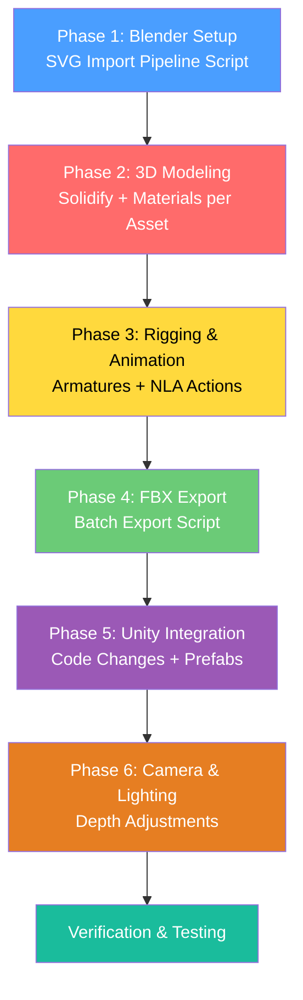

# SVG → Blender 3D Animated Assets Pipeline

## Goal
Convert all 19 static SVG game assets from **Ganga Ki Bagiya** into animated 3D models in Blender, export as FBX with embedded animations, and integrate into the Unity 2D game — replacing the current flat `SpriteRenderer` pipeline with animated `MeshRenderer`/`SkinnedMeshRenderer` objects while preserving the paper-craft visual style.

## Current State

### Asset Inventory (19 SVGs + PNGs)

| # | Category | File | Current Role in Game | Visual Style |
|---|----------|------|---------------------|--------------|
| 1 | **Background** | `sun.svg` | Static sky decoration at (-0.32w, 3.15) | Orange starburst, paper texture |
| 2 | **Background** | `clod back 2.svg` | Static far cloud at (-0.16w, 2.75) | Small grey cloud |
| 3 | **Background** | `cloud 1.svg` | Static cloud at (0.38w, 2.15) | Grey spiral-swirl cloud |
| 4 | **Background** | `cloud 2.svg` | Static cloud at (-0.42w, 2.15) | Grey spiral-swirl cloud |
| 5 | **Background** | `cloud 3.svg` | Static cloud at (0.02w, 3.25) | Grey spiral-swirl cloud |
| 6 | **Background** | `cloud back 1.svg` | Static far cloud at (0.3w, 3.0) | Grey spiral-swirl cloud |
| 7 | **Water** | `fast river.svg` | Top lane (तेज़ धार), highest water yield | Dark blue waves, aggressive curls |
| 8 | **Water** | `medium river.svg` | Middle lane (मध्यम), medium water yield | Medium blue waves |
| 9 | **Water** | `slow river.svg` | Bottom lane (धीमी), lowest water yield | Light blue, gentle waves |
| 10 | **Obstacle** | `boat.svg` | **Hazard** (spriteIndex 0) — ends run on hit | Sailboat with striped sail |
| 11 | **Obstacle** | `croc.svg` | **Scenery** (spriteIndex 1) — riverbank decoration | Green cartoon crocodile |
| 12 | **Obstacle** | `dirt.svg` | **Scenery** (spriteIndex 2) — riverbank decoration | Brown mud patches |
| 13 | **Obstacle** | `diya.svg` | **Hazard** (spriteIndex 3) — ends run on hit | Oil lamp with flame |
| 14 | **Obstacle** | `dolphine.svg` | **Hazard** (spriteIndex 4) — ends run on hit | Pink leaping dolphin |
| 15 | **Obstacle** | `fish 1.svg` | **Scenery** (spriteIndex 5) — riverbank decoration | Orange-yellow koi fish |
| 16 | **Obstacle** | `fish 2.svg` | **Scenery** (spriteIndex 6) — riverbank decoration | Orange-yellow goldfish |
| 17 | **Obstacle** | `flower.svg` | **Scenery** (spriteIndex 7) — riverbank decoration | Pink lotus on lily pads |
| 18 | **Obstacle** | `plastic.svg` | **Hazard** (spriteIndex 8) — ends run on hit | Crushed plastic bottle |
| 19 | **Obstacle** | `pollution.svg` | **Hazard** (spriteIndex 9) — ends run on hit | Sewage pipe draining |

### Game Architecture (from [Phase1GameController.cs](file:///Users/anand/Desktop/ganga_ki_bagiya_u/Assets/GangaKiBagiya/Scripts/Phase1GameController.cs))
- **3 river lanes** at Y positions: `{1.25, 0.0, -1.25}`
- **Hazard indices**: `{0, 3, 4, 8, 9}` → boat, diya, dolphine, plastic, pollution
- **Scenery indices**: `{1, 2, 5, 6, 7}` → croc, dirt, fish 1, fish 2, flower (static riverbank)
- **Collector** ("Matka") at progress 0.82 — a clay pot placeholder
- Obstacles spawn left, travel right across screen at lane-specific speeds
- **Orthographic camera**: size 5, aspect ~0.56 (portrait mobile)

---

## Proposed Changes

### Phase 1: Blender Project Setup & SVG Import Pipeline

#### [NEW] `Assets/Blender/scripts/svg_import_pipeline.py`
A headless Blender Python script that batch-imports all 19 SVGs, converts curves to meshes, and organizes them into named collections.

```python
# Pseudocode — the actual script will be fully functional
import bpy, os

SVG_MANIFEST = {
    "background": ["sun", "clod back 2", "cloud 1", "cloud 2", "cloud 3", "cloud back 1"],
    "water": ["fast river", "medium river", "slow river"],
    "obstacles": ["boat", "croc", "dirt", "diya", "dolphine", "fish 1", "fish 2", "flower", "plastic", "pollution"],
}

for category, names in SVG_MANIFEST.items():
    for name in names:
        # 1. Import SVG → Curve objects
        bpy.ops.import_curve.svg(filepath=f"Assets/{category}/{name}.svg")
        # 2. Select all newly imported curves
        # 3. Join into single object, name it properly
        # 4. Convert curves → mesh (bpy.ops.object.convert(target='MESH'))
        # 5. Add Solidify modifier for 3D depth (0.02–0.05 units)
        # 6. Apply materials matching SVG fill colors
        # 7. Move to named collection
```

**Key technique**: SVG import creates Bézier curve objects. We'll:
1. **Join** related curves into a single object per asset
2. **Solidify** to give paper-craft depth (thin extrusion ~0.02–0.05 units)
3. **Preserve fill colors** from SVG as Blender materials
4. **UV unwrap** for any texture needs

#### [NEW] `Assets/Blender/GangaKiBagiya.blend`
Master Blender file containing all assets organized into collections:
```
📁 Scene Collection
├── 📁 Background
│   ├── Sun
│   ├── Cloud_Back_1
│   ├── Cloud_Back_2
│   ├── Cloud_1, Cloud_2, Cloud_3
├── 📁 Water
│   ├── Fast_River
│   ├── Medium_River
│   ├── Slow_River
├── 📁 Obstacles_Hazards
│   ├── Boat
│   ├── Diya
│   ├── Dolphine
│   ├── Plastic
│   ├── Pollution
├── 📁 Obstacles_Scenery
│   ├── Croc
│   ├── Dirt
│   ├── Fish_1, Fish_2
│   ├── Flower
```

---

### Phase 2: 3D Modeling & Materials

Each asset gets a "2.5D paper-craft" treatment — flat vector shapes extruded into thin 3D solids with beveled edges, preserving the textured/grainy look of the originals.

#### Modeling approach per asset type:

| Asset | 3D Technique | Depth | Notes |
|-------|-------------|-------|-------|
| **Sun** | Flat disc + starburst spines as separate mesh | 0.03 | Spines slightly offset in Z for layered feel |
| **Clouds** (×5) | Overlapping spherical blobs, stylized | 0.04 | Spiral swirl detail via normal map or geometry |
| **River lanes** (×3) | Wavy plane with wave-crest geometry | 0.02 | Wave height varies per speed tier |
| **Boat** | Hull + sail as separate meshables, rigged | 0.05 | Sail as cloth-like deform target |
| **Croc** | Multi-part body (jaw, body, tail, bumps) | 0.04 | Jaw and tail as separate bones |
| **Dirt** | Flat elliptical blobs, stacked | 0.02 | Minimal — just gentle float |
| **Diya** | Lamp bowl + flame mesh | 0.04 | Flame as emissive, separate for animation |
| **Dolphine** | Streamlined body, fins, tail | 0.05 | Full arc-jump rig |
| **Fish 1 & 2** | Body + tail fin + side fins | 0.04 | Tail as wiggle bone |
| **Flower** | Petals + lily pad layers | 0.03 | Petals bloom/sway, pad floats |
| **Plastic** | Crushed bottle shape | 0.03 | Tumble rotation |
| **Pollution** | Pipe + sewage flow | 0.05 | Flow as animated mesh deform |

#### Materials Strategy
- **Shader**: Principled BSDF with low roughness (~0.7), slight metallic tint
- **Textures**: Bake the SVG fill patterns to UV maps; add subtle paper-grain overlay via procedural noise
- **Color palette**: Extracted directly from SVG fills to maintain visual consistency
- Export-safe: all materials use glTF-compatible nodes

---

### Phase 3: Rigging & Animation

Each asset gets an **Armature** with bones for the animated parts. All animations are **NLA strips** (looping actions) for clean FBX export.

#### Animation Specifications

##### Background Animations

| Asset | Animation Name | Type | Duration | Description |
|-------|---------------|------|----------|-------------|
| **Sun** | `sun_rotate` | Loop | 120f (4s @30fps) | Slow continuous rotation around Z-axis, ±3° oscillation for pulsing glow feel |
| **Sun** | `sun_pulse` | Loop | 90f (3s) | Subtle scale pulse 1.0→1.04→1.0 with ease-in/ease-out |
| **Cloud 1–3** | `cloud_drift` | Loop | 240f (8s) | Gentle horizontal drift ±0.3 units with sinusoidal ease |
| **Cloud Back 1–2** | `cloud_back_drift` | Loop | 360f (12s) | Slower parallax drift ±0.15 units — half speed of foreground clouds |

##### Water Animations

| Asset | Animation Name | Type | Duration | Description |
|-------|---------------|------|----------|-------------|
| **Fast River** | `river_fast_flow` | Loop | 30f (1s) | Aggressive wave crest displacement via shape keys; wave peaks translate right rapidly; UV scroll for surface shimmer |
| **Medium River** | `river_medium_flow` | Loop | 45f (1.5s) | Moderate wave displacement; smoother crests; medium-speed UV scroll |
| **Slow River** | `river_slow_flow` | Loop | 90f (3s) | Gentle undulation; minimal crest movement; slow UV scroll for calm water |

> **Technique**: Each river is a subdivided plane with **Shape Keys** driving vertex displacement in a wave pattern. A **Wave modifier** (baked to shape keys for FBX compatibility) creates the motion. UV coordinates animate via material node offset.

##### Obstacle Animations — Hazards

| Asset | Animation Name | Type | Duration | Description |
|-------|---------------|------|----------|-------------|
| **Boat** | `boat_idle` | Loop | 60f (2s) | Rock side-to-side ±8° around X-axis (roll); gentle Y bob ±0.02 units |
| **Boat** | `boat_sail_flutter` | Loop | 45f (1.5s) | Sail cloth bones oscillate ±5° in wind |
| **Diya** | `diya_idle` | Loop | 30f (1s) | Flame scale pulse 0.9→1.15→0.9; flame sway ±4° Z rotation; subtle ember particles (baked to mesh) |
| **Diya** | `diya_float` | Loop | 90f (3s) | Whole diya bobs ±0.015 units Y with slow rotation ±2° |
| **Dolphine** | `dolphine_leap` | Loop | 60f (2s) | Full arc: rise from water → peak → splash down; body curves via spine bones; tail fin flaps at apex |
| **Dolphine** | `dolphine_swim` | Loop | 36f (1.2s) | Horizontal swim: tail oscillates ±15°, body undulates subtly |
| **Plastic** | `plastic_tumble` | Loop | 120f (4s) | Slow tumbling rotation on all 3 axes; gentle float bob |
| **Plastic** | `plastic_bob` | Loop | 75f (2.5s) | Half-submerged bobbing ±0.02 units Y |
| **Pollution** | `pollution_flow` | Loop | 60f (2s) | Sewage stream mesh deforms in pouring motion via shape keys; drip particles (baked geometry) |
| **Pollution** | `pollution_drip` | Loop | 45f (1.5s) | Periodic drip blobs scale up, drop, and reset |

##### Obstacle Animations — Scenery

| Asset | Animation Name | Type | Duration | Description |
|-------|---------------|------|----------|-------------|
| **Croc** | `croc_idle` | Loop | 90f (3s) | Jaw opens/closes ±12°; tail sways ±8° with 2-bone chain; eyes blink (scale Y to 0 and back, 1f) every 3s |
| **Croc** | `croc_snap` | OneShot | 20f (0.67s) | Fast jaw snap open→close; body lurches forward 0.05 units |
| **Dirt** | `dirt_float` | Loop | 120f (4s) | Very subtle bob ±0.008 units Y; slow drift rotation ±1° |
| **Fish 1** | `fish1_swim` | Loop | 24f (0.8s) | Tail fin oscillates ±20°; body sways ±3° counter to tail; mouth opens slightly |
| **Fish 2** | `fish2_swim` | Loop | 30f (1s) | Tail sweeps ±18°; side fins flap ±10°; gentle Y bob |
| **Flower** | `flower_bloom` | OneShot | 60f (2s) | Petals open from closed bud → full bloom via bone scale/rotation |
| **Flower** | `flower_sway` | Loop | 90f (3s) | Gentle sway ±5° on stem; lily pad bobs ±0.01 units |

---

### Phase 4: FBX Export Pipeline

#### [NEW] `Assets/Blender/scripts/export_all_fbx.py`
Headless Blender script to batch-export every asset as an individual FBX with embedded animations.

```python
# Export configuration per asset
EXPORT_CONFIG = {
    "path_mode": 'COPY',          # Embed textures
    "embed_textures": True,
    "use_selection": True,
    "apply_scale_options": 'FBX_SCALE_ALL',
    "bake_anim": True,
    "bake_anim_use_all_actions": True,
    "bake_anim_step": 1.0,
    "mesh_smooth_type": 'FACE',
    "use_mesh_modifiers": True,
    "add_leaf_bones": False,
}

# Output structure:
# Assets/Models/background/sun.fbx
# Assets/Models/background/cloud_1.fbx
# ...
# Assets/Models/water/fast_river.fbx
# ...
# Assets/Models/obstacles/boat.fbx
# Assets/Models/obstacles/croc.fbx
# ...
```

Each FBX contains:
- Mesh geometry (solidified SVG shapes)
- Armature with bones
- All animation actions baked to keyframes
- Materials with embedded textures

#### Output File Structure
```
Assets/
├── Models/
│   ├── background/
│   │   ├── sun.fbx
│   │   ├── cloud_1.fbx
│   │   ├── cloud_2.fbx
│   │   ├── cloud_3.fbx
│   │   ├── cloud_back_1.fbx
│   │   └── cloud_back_2.fbx
│   ├── water/
│   │   ├── fast_river.fbx
│   │   ├── medium_river.fbx
│   │   └── slow_river.fbx
│   └── obstacles/
│       ├── boat.fbx
│       ├── croc.fbx
│       ├── dirt.fbx
│       ├── diya.fbx
│       ├── dolphine.fbx
│       ├── fish_1.fbx
│       ├── fish_2.fbx
│       ├── flower.fbx
│       ├── plastic.fbx
│       └── pollution.fbx
└── Blender/
    ├── GangaKiBagiya.blend          # Master file
    ├── scripts/
    │   ├── svg_import_pipeline.py   # Import automation
    │   └── export_all_fbx.py        # Export automation
    └── textures/                     # Baked textures
```

---

### Phase 5: Unity Integration — Code Changes

> [!WARNING]
> This phase changes the core rendering pipeline from 2D `SpriteRenderer` to 3D animated `MeshRenderer`. The game's 2D physics, orthographic camera, and lane logic remain unchanged.

#### [MODIFY] [Phase1GameController.cs](file:///Users/anand/Desktop/ganga_ki_bagiya_u/Assets/GangaKiBagiya/Scripts/Phase1GameController.cs)

**Key changes:**

1. **Replace sprite fields with prefab fields:**
```diff
-[SerializeField] private Sprite[] backgroundSprites = Array.Empty<Sprite>();
-[SerializeField] private Sprite[] riverLaneSprites = Array.Empty<Sprite>();
-[SerializeField] private Sprite[] obstacleSprites = Array.Empty<Sprite>();
+[SerializeField] private GameObject[] backgroundPrefabs = Array.Empty<GameObject>();
+[SerializeField] private GameObject[] riverLanePrefabs = Array.Empty<GameObject>();
+[SerializeField] private GameObject[] obstaclePrefabs = Array.Empty<GameObject>();
```

2. **Replace `AddSprite()` with `AddModel()`:**
```diff
-private SpriteRenderer AddSprite(string name, Sprite sprite, Vector2 position, float desiredHeight, int order, float alpha)
+private GameObject AddModel(string name, GameObject prefab, Vector2 position, float desiredHeight, int sortOrder)
 {
-    if (sprite == null) return null;
-    GameObject go = new GameObject(name);
+    if (prefab == null) return null;
+    GameObject go = Instantiate(prefab, worldRoot);
+    go.name = name;
     go.transform.position = new Vector3(position.x, position.y, -sortOrder * 0.01f);
-    float scale = desiredHeight / Mathf.Max(0.01f, sprite.bounds.size.y);
+    Bounds bounds = CalculateBounds(go);
+    float scale = desiredHeight / Mathf.Max(0.01f, bounds.size.y);
     go.transform.localScale = Vector3.one * scale;
-    SpriteRenderer renderer = go.AddComponent<SpriteRenderer>();
-    renderer.sprite = sprite;
-    renderer.sortingOrder = order;
+    // Animation plays automatically via Animator component on prefab
     return go;
 }
```

3. **Replace obstacle pool from `SpriteRenderer` to `GameObject` with `Animator`:**
```diff
-private readonly Dictionary<int, SpriteRenderer> activeObstacleViews = ...;
-private readonly List<SpriteRenderer> obstaclePool = ...;
+private readonly Dictionary<int, GameObject> activeObstacleViews = ...;
+private readonly List<GameObject> obstaclePool = ...;
```

4. **`UpdateObstacleViews()` — swap sprite assignment for prefab instantiation:**
```diff
-renderer.sprite = GetSprite(obstacleSprites, obstacle.spriteIndex);
+// Destroy old and instantiate correct prefab
+var view = AcquireObstacleView(obstacle.spriteIndex);
+var animator = view.GetComponent<Animator>();
+if (animator != null) animator.Play("idle", 0, Random.value); // Random phase offset
```

5. **River lanes use `Instantiate` with animated prefabs instead of stretched sprites:**
```diff
-SpriteRenderer renderer = AddSprite("River Lane " + (lane + 1), sprite, ...);
-renderer.transform.localScale = new Vector3(worldWidth * 1.08f / spriteSize.x, ...);
+GameObject riverModel = AddModel("River Lane " + (lane + 1), riverLanePrefabs[lane], ...);
+// Scale to fill screen width, animation handles wave motion
```

#### [MODIFY] [Phase1SceneSetup.cs](file:///Users/anand/Desktop/ganga_ki_bagiya_u/Assets/GangaKiBagiya/Editor/Phase1SceneSetup.cs)

Update the editor build script to wire up FBX prefabs instead of PNG sprites:

```diff
-SetSpriteArray(serialized.FindProperty("backgroundSprites"), "Assets/background", BackgroundNames);
-SetSpriteArray(serialized.FindProperty("riverLaneSprites"), "Assets/water", RiverNames);
-SetSpriteArray(serialized.FindProperty("obstacleSprites"), "Assets/obstacles", ObstacleNames);
+SetPrefabArray(serialized.FindProperty("backgroundPrefabs"), "Assets/Models/background", BackgroundModelNames);
+SetPrefabArray(serialized.FindProperty("riverLanePrefabs"), "Assets/Models/water", RiverModelNames);
+SetPrefabArray(serialized.FindProperty("obstaclePrefabs"), "Assets/Models/obstacles", ObstacleModelNames);
```

```csharp
private static void SetPrefabArray(SerializedProperty property, string directory, string[] names)
{
    property.arraySize = names.Length;
    for (int i = 0; i < names.Length; i++)
    {
        string path = directory + "/" + names[i] + ".fbx";
        GameObject prefab = AssetDatabase.LoadAssetAtPath<GameObject>(path);
        if (prefab == null)
            throw new InvalidOperationException("Missing FBX model: " + path);
        property.GetArrayElementAtIndex(i).objectReferenceValue = prefab;
    }
}
```

#### [NEW] `Assets/Models/AnimatorControllers/`
Unity Animator Controllers for each animated asset, configured with:
- Default **Idle** state (looping animation)
- Transition triggers for one-shot animations (e.g., `croc_snap`, `flower_bloom`)
- Random speed multiplier parameter to desync identical obstacles

---

### Phase 6: Depth & Camera Adjustments

Since we're adding Z-depth to previously flat sprites:

| Setting | Current | New | Why |
|---------|---------|-----|-----|
| Camera projection | Orthographic | Orthographic (unchanged) | Keep 2D gameplay feel |
| Camera size | 5 | 5 (unchanged) | Layout stays same |
| Object Z-positions | All 0 | Layered: sky -0.1, clouds -0.05, river 0, obstacles 0.01, collector 0.02 | Sorting by Z instead of sortingOrder |
| Lighting | None (2D) | Single directional light, soft shadows | Subtle 3D depth cues |

---

## User Review Required

> [!IMPORTANT]
> **Breaking change**: The `SpriteRenderer`-based rendering is replaced with `MeshRenderer`/`SkinnedMeshRenderer`. The old PNG sprites remain in the project but will no longer be referenced by the game controller. This is a one-way migration for the rendering system.

> [!IMPORTANT]
> **Blender must be open** for the Blender MCP server to work (it connects via a bridge add-on). The headless CLI pipeline (`blender -b --python`) does NOT require the GUI but does require the full Blender app bundle.

> [!WARNING]
> The SVG files are quite large (5–13 MB each), likely due to embedded raster texture patterns within the SVG paths. The import may produce hundreds of curve objects per file. The pipeline script will need to intelligently group and simplify these.

## Open Questions

> [!IMPORTANT]
> **Q1**: The current "Matka" (clay water pot / collector) is a plain colored square placeholder. Should I also create a proper 3D animated matka model in Blender? (bobbing animation as it collects water, splash effect on obstacle hit)

> [!IMPORTANT]
> **Q2**: Several SVGs contain embedded raster textures (paper-grain patterns baked into the vector paths). When importing to Blender, these may not carry over cleanly. Options:
> - **(A)** Re-create the paper-craft texture procedurally in Blender (noise + color ramp)
> - **(B)** Use the existing PNGs as UV-mapped textures on the 3D models
> - **(C)** Clean flat colors only (simplify the look)

> [!IMPORTANT]
> **Q3**: The game currently has no particle effects. Should I add particle-like baked geometry for:
> - Water splashes when obstacles enter/exit lanes
> - Flame embers on the diya
> - Bubble trails behind fish/dolphin

## Verification Plan

### Automated Tests
```bash
# 1. Verify all FBX files were generated
find Assets/Models -name "*.fbx" | wc -l  # Expected: 19

# 2. Verify Blender export script runs without errors
blender -b Assets/Blender/GangaKiBagiya.blend --python Assets/Blender/scripts/export_all_fbx.py

# 3. Run existing Unity edit-mode tests
# (via Unity Test Runner — existing tests in Assets/GangaKiBagiya/Tests/)
```

### Manual Verification
1. **Visual comparison**: Open each FBX in Unity, compare side-by-side with original PNG to confirm shapes and colors match
2. **Animation playback**: Preview each animation clip in Unity's Animation window — verify loop points, timing, and bone deformations
3. **In-game test**: Run the game in Unity Play mode:
   - Verify all 3 river lanes animate with correct wave speeds
   - Verify obstacles spawn with idle animations
   - Verify background clouds drift and sun pulses
   - Verify collision detection still works with 3D meshes
   - Verify no Z-fighting between overlapping objects
4. **Performance**: Check frame rate on target Android device — animated 3D meshes should stay under 2ms GPU per frame
5. **Build test**: Run `Ganga Ki Bagiya > Phase 1 > Build Android APK` to confirm APK builds successfully

## Execution Order



**Estimated effort**: Phases 1–4 (Blender work) are the bulk — each asset needs individual attention for modeling, rigging, and animation. Phase 5–6 (Unity integration) are more mechanical code changes.
