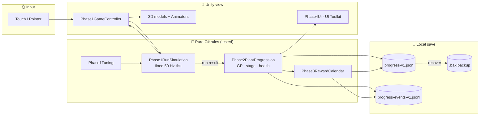
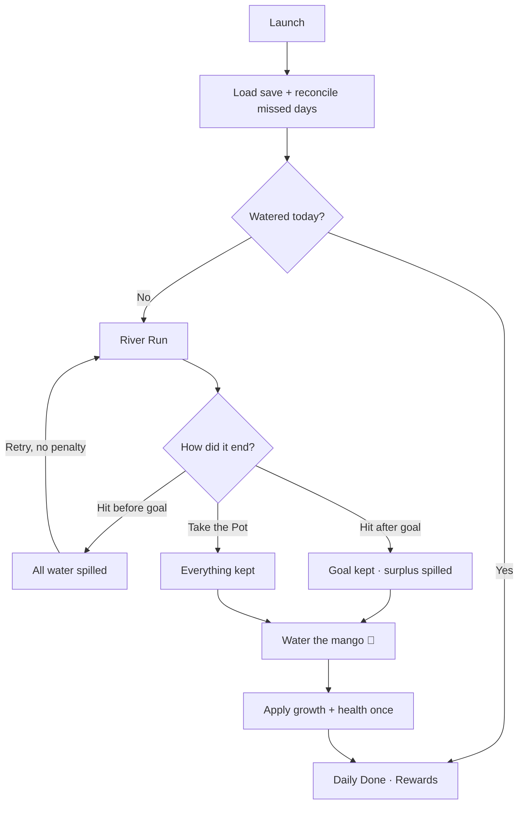
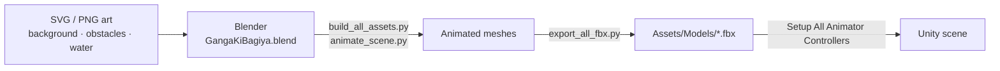

<div align="center">

# 🌊 गंगा की बगिया · Ganga ki Bagiya

**Collect clean water. Protect the river. Grow a little every day.**

*साफ़ पानी भरो। नदी बचाओ। रोज़ थोड़ा बढ़ो।*

[](https://unity.com/releases/editor/archive)
[](https://docs.unity3d.com/Packages/com.unity.render-pipelines.universal@17.0/manual/index.html)
[](#-tech-stack)
[](#-building-for-android)
[](#-localization)
[](#-running-tests)

A casual **one-finger timing game** with a **daily plant-care loop**, set on a paper-cut Ganga.
Built for the **Dainik Bhaskar Game Lab 2026**.

[Gameplay](#-how-to-play) · [Screenshots](#-screenshots) · [Getting Started](#-getting-started) · [Architecture](#-architecture) · [Docs](#-design-documents) · [Roadmap](#-roadmap)

</div>

---

## 📖 Table of Contents

- [About the Game](#-about-the-game)
- [How to Play](#-how-to-play)
- [Screenshots](#-screenshots)
- [Features](#-features)
- [Getting Started](#-getting-started)
- [Building for Android](#-building-for-android)
- [Running Tests](#-running-tests)
- [Project Structure](#-project-structure)
- [Architecture](#-architecture)
- [Tuning the Game](#-tuning-the-game)
- [Localization](#-localization)
- [Art Pipeline](#-art-pipeline)
- [Design Documents](#-design-documents)
- [Roadmap](#-roadmap)
- [Author](#-author)

---

## 🪔 About the Game

You fill a **matka** with clean water from a three-lane river, steer around whatever floats past, and carry the water home to a **mango tree** that grows a little each day.

| | |
|---|---|
| 🎮 **Genre** | Casual one-finger timing game + daily plant-growing layer |
| 📱 **Platform** | Android first. iOS and WebGL come later |
| ⏱️ **Session** | 1–3 minutes per run, one successful watering per day |
| 🗣️ **Languages** | Hindi first, with an English toggle |
| 👥 **Audience** | Hindi-speaking adults aged 24–44 who play on their phones, many of them not regular gamers |
| 🚫 **No** | Ads, purchases, real-money mechanics or copyrighted material |

### Design pillars

> **1. Immediate clarity:** touch to collect, slide to switch, lift to stop.
> **2. Risk is optional after success:** once the goal is reached, bank safely or push for bonus.
> **3. Daily care without punishment spirals:** failed runs never hurt the plant, and it never dies.
> **4. Learning in context:** every encounter teaches a short river or plant fact.
> **5. Indian folk-art identity:** paper-cut layers, stop-motion movement and riverside imagery.

---

## 🎮 How to Play

<table>
<tr>
<td width="55%" valign="top">

### Controls: a single finger

| Action | Result |
|---|---|
| 👆 **Touch a lane** | Start collecting water from it |
| ↕️ **Slide while holding** | Switch lanes instantly |
| ✋ **Lift your finger** | Stop collecting (the run continues) |
| 🏺 **Take the Pot** | Bank your water once the goal is met |

### The river

| Lane | Current | Water / sec | Obstacle speed |
|---|---|---:|---:|
| 🔵 Top | तेज़ धार (Fast) | **7.5** | 150 px/s |
| 🔷 Middle | मध्यम (Medium) | **4.2** | 100 px/s |
| 💧 Bottom | धीमी (Slow) | **2.2** | 62 px/s |

The fast lane fills the pot about **3× faster** than the slow one, but its obstacles come quicker and closer together. Each run you trade safety against speed.

</td>
<td width="45%" align="center">


<sub><i>Visual target: paper-cut river, matka and garden</i></sub>

</td>
</tr>
</table>

### Bank or gamble?

The daily goal is **`G = 24 + 8 × (stage − 1)`** units of water.

| What happens | Water kept | Plant watered? |
|---|---|:---:|
| 💥 Hit **before** reaching the goal | Nothing, all of it spills | ❌ Retry freely |
| 💥 Hit **after** reaching the goal | Exactly the goal; the surplus spills | ✅ |
| 🏺 **Take the Pot** after the goal | Everything, including the surplus | ✅ |

**Growth points per watering:** `1 + floor((kept − G) / 30)`. Bonus points only count water you actually kept.

> [!TIP]
> At Stage 1 the goal is 24. A hit at 40 keeps 24 and gives no bonus. Banking at 54 keeps all 54 and earns **+1 bonus GP**.

### Obstacles: things you shouldn't disturb

| | Obstacle | Hit message | What it teaches |
|:---:|---|---|---|
| 🛍️ | Plastic bag | *You scooped up dirty water* | Plastic lasts for years and harms river life |
| 🛢️ | Foam & oil | *You scooped up dirty water* | Untreated waste pollutes rivers |
| ⛵ | Boat | *Give the boat way* | Boats are a livelihood along the Ganga |
| 🐬 | Ganga dolphin | *You scared the dolphin* | India's national aquatic animal navigates by sound |
| 🪔 | Diya with marigolds | *Let the diya float by* | A respectful moment of letting it pass |

> [!NOTE]
> River animals and cultural objects are never "enemies". The player is learning **not to disturb them**. All facts are pending editorial verification before release.

### 🥭 The mango tree

| Stage | Name | Look | GP to advance |
|:---:|---|---|:---:|
| 1 | बीज · Seed | Seed half-buried in soil | 2 |
| 2 | अंकुर · Sprout | Thin stem, copper-red leaves | 2 |
| 3 | पौधा · Seedling | Taller stem, green leaves | 2 |
| 4 | छोटा पेड़ · Sapling | Trunk and leaf pairs, a butterfly 🦋 | 3 |
| 5 | बौर · Blossom | Flowering canopy, bees 🐝 | 3 |
| 6 | फल · Fruiting | Hanging mangoes, a parrot 🦜 and a squirrel 🐿️ | Final |

**Health (0–3):** each missed day costs 1 health, and each watering restores 2. At 0 health the plant **wilts, but it never dies**, and growth is never lost.

---

## 📸 Screenshots

<div align="center">

| Main menu | Gameplay HUD | Goal secured |
|:---:|:---:|:---:|
|  |  |  |
| **Result** | **Daily done** | **Settings** |
|  |  |  |

</div>

<details>
<summary><b>More screens: onboarding, profile, pause, save recovery</b></summary>
<br/>

| Welcome | Profile form | Profile preview | Edit profile |
|:---:|:---:|:---:|:---:|
|  |  |  |  |
| **Welcome message** | **Pause** | **Corrupt-save recovery** | **Rapid-tap guard** |
|  |  |  |  |

</details>

---

## ✨ Features

### Implemented

- [x] **Deterministic run simulation**: fixed-step at 50 ticks/sec, with water stored in thousandths so the frame rate can't cause drift
- [x] **Three-lane river** with per-lane water rates, obstacle speeds and spawn gaps
- [x] **Difficulty ramp**: up to +90% speed over 80 s of *simulated* time, plus +5% per plant stage
- [x] **Goal-secured flow**: Take the Pot, plus the correct retained and spilled water on a post-goal hit
- [x] **Six-stage mango progression** with surplus GP carried over and a cap at Stage 6
- [x] **Plant health** with reconciliation for missed days
- [x] **Seven-day reward calendar** (upcoming / available / claimed / forfeited)
- [x] **Crash-safe local save**: JSON snapshot, an append-only event journal and a `.bak` backup for recovery
- [x] **Player profile**: name, optional age, avatar, with validation
- [x] **UI Toolkit interface**: onboarding, home, HUD, pause, result, watering, done, rewards and settings
- [x] **Hindi and English** localization using Hind and Yatra One fonts
- [x] **Procedural UI sounds**: no audio assets, and they can be turned off in Settings
- [x] **Animated 3D models** made in Blender, with Animator Controllers and fallback sprites
- [x] **33 EditMode tests** covering simulation, progression, persistence, localization and profile

### Planned

- [ ] Account sync: Firebase Auth (Google sign-in), Google Cloud Run and Firestore
- [ ] Golden mahseer and the lotus mechanic (lotus is still undecided between hazard and bonus)
- [ ] Final Day 1–7 reward items
- [ ] Signed Android release build and a device QA matrix
- [ ] iOS and WebGL builds

---

## 🚀 Getting Started

### Prerequisites

| Tool | Version | Notes |
|---|---|---|
| **Unity Hub** | Latest | [Download](https://unity.com/download) |
| **Unity Editor** | `6000.6.4f1` | Install with **Android Build Support** (SDK, NDK, OpenJDK) |
| **Git LFS** | 3.x | **Required**, because images, models, fonts and `.blend` files are stored in LFS |
| **Blender** | 4.x | *Optional*, only needed to edit `Assets/Blender/GangaKiBagiya.blend` |

### Clone and open

```bash
# 1. Install Git LFS once per machine
git lfs install

# 2. Clone; LFS assets download automatically
git clone https://github.com/anandsharmacy/ganga_ki_bagiya_u.git
cd ganga_ki_bagiya_u

# 3. If the images look like small text files, fetch the LFS objects
git lfs pull
```

Then open **Unity Hub → Add → Add project from disk** and choose the cloned folder. The first import rebuilds `Library/`, which can take a few minutes.

### Play in the Editor

1. Open **`Assets/Scenes/SampleScene.unity`**
2. Menu bar: **Ganga Ki Bagiya → Phase 1 → Build Playable Scene**. This sets up the camera, models, animators and UI.
3. Set the Game view to a **portrait** aspect ratio (for example 9:16).
4. Press ▶ **Play**, then click and hold a lane and drag to switch.

> [!IMPORTANT]
> Images showing as broken, or models missing, almost always means the Git LFS objects weren't pulled. Run `git lfs pull` and reopen the project.

---

## 📦 Building for Android

**One-click option** from the Unity menu:

```
Ganga Ki Bagiya → Phase 1 → Build Android APK
```

This rebuilds the scene, switches the target to Android and writes the APK to:

```
Builds/Android/GangaKiBagiya-Phase1.apk
```

**Install it on a device:**

```bash
adb install -r Builds/Android/GangaKiBagiya-Phase1.apk
```

> [!WARNING]
> The current build is **debug-signed** with the default `com.DefaultCompany` identifier. Before a store release, set a package ID, a release keystore and the target API in **Player Settings**.

---

## 🧪 Running Tests

There are 33 EditMode tests across 5 suites:

| Suite | Tests | Covers |
|---|:---:|---|
| `Phase1RunSimulationTests` | 10 | Lane rates, hits, goal and bank, retained-water scoring, determinism |
| `Phase2PlantProgressionTests` | 7 | GP thresholds, surplus carry-over, Stage 6 cap, health |
| `Phase3PersistenceTests` | 6 | Snapshot and journal, backup recovery, idempotent claims |
| `PlayerProfileTests` | 5 | Name, age and avatar validation |
| `Phase4LocalizationTests` | 5 | Hindi and English strings, stage names |

**In the Editor:** go to **Window → General → Test Runner → EditMode → Run All**.

**From the command line (CI):**

```bash
/Applications/Unity/Hub/Editor/6000.6.4f1/Unity.app/Contents/MacOS/Unity \
  -batchmode -nographics -projectPath . \
  -runTests -testPlatform EditMode \
  -testResults ./test-results.xml
```

---

## 🗂️ Project Structure

```
ganga_ki_bagiya_u/
├── Assets/
│   ├── GangaKiBagiya/              # ⭐ All game code
│   │   ├── Scripts/                # Runtime (GangaKiBagiya.Runtime.asmdef)
│   │   │   ├── Phase1RunSimulation.cs    # Deterministic fixed-step river run
│   │   │   ├── Phase1Tuning.cs           # Every speed, rate, gap and goal
│   │   │   ├── Phase1GameController.cs   # Input, rendering, run lifecycle
│   │   │   ├── Phase2PlantProgression.cs # Growth points, stages, health
│   │   │   ├── Phase3LocalSave.cs        # Snapshot + journal + backup, rewards
│   │   │   ├── Phase4Ui*.cs              # UI Toolkit screens and onboarding
│   │   │   ├── Phase4Localization.cs     # Hindi / English strings
│   │   │   ├── PlayerProfile.cs          # Profile model and validation
│   │   │   └── Ui{Theme,Motion,Audio,Settings}.cs
│   │   ├── Editor/                 # Scene builder, APK builder, animator setup
│   │   ├── Resources/Fonts/        # Hind, Yatra One
│   │   └── Tests/EditMode/         # NUnit test suites
│   ├── Models/                     # Exported FBX + AnimatorControllers
│   ├── Blender/                    # Source .blend, textures, Python export scripts
│   ├── background/                 # Sun, clouds (SVG + PNG)
│   ├── obstacles/                  # Boat, diya, dolphin, plastic, pollution, …
│   ├── water/                      # Fast / medium / slow river lanes
│   ├── Scenes/SampleScene.unity    # The game scene
│   └── Settings/                   # URP assets, build profiles
├── Documentation /                 # GDD, SRS, TDD, plans, audits, UI captures
├── Packages/                       # Unity package manifest
└── ProjectSettings/
```

---

## 🏗️ Architecture

Game rules are **pure C#** and kept apart from Unity rendering, so they can be tested, replayed and saved exactly as they are.



### Daily loop



### Key engineering decisions

| Decision | Why |
|---|---|
| **Integer milli-water units** | No floating-point drift between frame rates or devices |
| **Fixed-step simulation** | The same seed and inputs give the same outcome, so runs can be replayed and saved |
| **Simulation time, not wall clock** | Backgrounding the app never speeds up difficulty or moves obstacles |
| **Snapshot + journal + backup** | A crash during a save never loses valid progress |
| **Idempotent watering and claims** | Reloading can never grant growth or rewards twice |
| **All tuning in one class** | Designers balance the game in `Phase1Tuning` without touching game logic |

---

## 🎛️ Tuning the Game

All gameplay numbers are in **[`Phase1Tuning.cs`](Assets/GangaKiBagiya/Scripts/Phase1Tuning.cs)** and can be edited in the Inspector:

| Field | Default | Meaning |
|---|---|---|
| `startingDailyGoal` | `24` | Stage 1 water goal |
| `dailyGoalIncreasePerStage` | `8` | Added to the goal for each stage |
| `ticksPerSecond` | `50` | Simulation rate |
| `laneWaterMilliUnitsPerSecond` | `7500, 4200, 2200` | Top / middle / bottom fill rates |
| `laneObstaclePixelsPerSecond` | `150, 100, 62` | Reference obstacle speeds |
| `laneObstacleGapsSeconds` | `1.8, 2.5, 3.2` | Time between spawns |
| `difficultyRampSeconds` | `80` | Time to reach maximum speed |
| `maximumSpeedMultiplier` | `1.9` | Speed cap (+90%) |
| `speedBonusPerAdditionalStage` | `0.05` | +5% per plant stage |
| `hitForgiveness` | `0.8` | Hitbox leniency |

---

## 🌐 Localization

- **Hindi (default)** and **English**, switched from **Settings**. The choice is saved with `PlayerPrefs`.
- Fonts: **[Hind](https://fonts.google.com/specimen/Hind)** for body text and **[Yatra One](https://fonts.google.com/specimen/Yatra+One)** for titles. Both are under the SIL Open Font License.
- All strings are in [`Phase4Localization.cs`](Assets/GangaKiBagiya/Scripts/Phase4Localization.cs).

---

## 🎨 Art Pipeline



**Style:** flat layered paper shapes with cream cut edges, hard offset shadows and paper grain, animated in ~12 fps stop-motion steps.
**Palette:** marigold, rani pink, vermilion and terracotta on kraft paper, with indigo-to-sky-blue river lanes (the darker the lane, the faster it is).

---

## 📚 Design Documents

All design documents are in [`Documentation /`](Documentation%20/):

| Document | Purpose |
|---|---|
| 📘 [Game Design Document](Documentation%20/Ganga_ki_Bagiya_GDD.md) | Vision, mechanics, obstacles, plant, art direction |
| 🗺️ [Game Flow & Level Design](Documentation%20/Ganga_ki_Bagiya_Game_Flow_and_Level_Design.md) | Screens, run states, difficulty, test scenarios |
| 📋 [Software Requirements (SRS)](Documentation%20/Ganga_ki_Bagiya_SRS.md) | Player-visible requirements |
| ⚙️ [Technical Design (TDD)](Documentation%20/Ganga_ki_Bagiya_TDD.md) | Engine, persistence, sync, deployment |
| 🛠️ [Implementation Plan](Documentation%20/Ganga_ki_Bagiya_Implementation_Plan.md) | Phased build plan |
| 🧾 [Phase 0 Audit & Decisions](Documentation%20/Phase_0_Audit_and_Decisions.md) | Prototype audit and baseline rules |
| 🎨 [UI/UX Overhaul Report](Documentation%20/UI_UX_Overhaul_Report.md) | UI redesign and screen captures |
| 🔍 [River Run Visual Audit](Documentation%20/River_Run_Visual_Audit_Report.md) · [Fix Plan](Documentation%20/River_Run_Visual_Fix_Plan.md) | Visual issues and fixes |
| 👁️ [Obstacle Visibility Fix Plan](Documentation%20/Obstacle_Visibility_Fix_Plan.md) | Hazard readability |
| 🧊 [Blender 3D Animation Plan](Documentation%20/blender_3d_animation_plan.md) | 3D model and animation pipeline |

---

## 🛣️ Roadmap

| Milestone | Scope | Status |
|---|---|:---:|
| **M1** · Vertical slice | 3 lanes, collection, hit, bank | ✅ |
| **M2** · Run balance | Deterministic run, encounter roster, goal secured | ✅ |
| **M3** · Daily care | Mango stages, GP, health, day reconciliation | ✅ |
| **M4** · Retention | Seven-day reward calendar | 🟡 Logic done, reward items still to be decided |
| **M5** · Persistence | Local save and recovery ✅ · cloud sync | 🟡 |
| **M6** · Polish & release | Adaptive layouts, device QA, content sign-off | ⏳ |

---

## 👤 Author

<div align="center">

**ANAND SHARMA**

[](https://github.com/anandsharmacy)

*Made for the Dainik Bhaskar Game Lab 2026*

</div>

---

<div align="center">
<sub>© 2026 Anand Sharma. All rights reserved.<br/>
Fonts © their respective authors under the SIL Open Font License 1.1.</sub>

**🌊 नदी बचाओ, बगिया बढ़ाओ 🥭**

</div>
